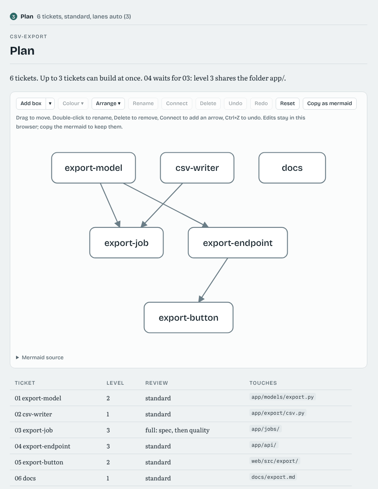

# Feature Flow

**Plan a feature as small tickets, then let fresh agents build and check each one, while a script, not the agent, decides when it is done.** Works with Claude Code and Codex.

[](https://github.com/hamilton-sky/feature-flow/actions/workflows/tests.yml)

[Quick start](#quick-start) · [How it works](docs/how-it-works.md) · [Commands](#commands) · [Docs](docs/README.md) · [Limits](#limits-and-status) · [What's new](docs/releases.md)

You describe a feature in the chat. feature-flow turns it into a plan of small **tickets** (one reviewable change each, with its own "Done when" checks), and you approve the plan. Then, in the session you are already in, each ticket is built by one fresh subagent and checked by another that never saw how it was built. A Python script runs your build and tests itself, refuses work that weakens the checks, and decides what happens next. One command, `/feature-flow`, does all of it.


**Is it for me?** Use it for a feature that touches several files and that you would split into a few pull requests anyway. Skip it for a one-line fix.

## Why use it

- **A second pair of eyes that was not in the room.** Every ticket is reviewed by a fresh agent that sees the ticket and the diff, never the builder's reasoning. In one field run on a separate application repo (two features), all 7 problems the reviews flagged were real.
- **Done means your tests pass when the script runs them,** not when the agent says so. The script reads the repo, runs your build, test and lint commands, and runs each ticket's own checks.
- **It catches shortcuts.** Skipped or deleted tests, silenced lint, lowered thresholds, assertions that cannot fail, and edits outside the files a ticket said it would change all send the ticket back.
- **You approve three times, then it runs by itself.** The idea, the option, and the plan; each stop can be skipped with "ok".
- **One word sets the pace.** `careful`, `standard` or `fast` picks how much review each ticket gets, and tickets that touch different files can build side by side.
- **Every run leaves a record** of what it cost and what each check caught, so a trial on your repo gives you numbers, not an impression.

## Quick start

**See it first, in 30 seconds.** From a clone (needs `bash`), with no agent and no setup:

```bash
git clone https://github.com/hamilton-sky/feature-flow.git && cd feature-flow
bash examples/demo.sh --open        # the animated ticket graph of a made-up project
```

**Before your first run.** You need `git`, Python 3.9 or later, and Claude Code or Codex. In the repo you want to work on:

- Work on a branch you can throw away (`git switch -c try-feature-flow`): the builder edits files, runs shell commands and commits after each ticket.
- Start from a clean tree, with build output in `.gitignore`: the run stops if the tree is dirty after a ticket.
- Have a test command that exits non zero when a test fails. A suite that runs in about a minute is best.

**Install.** With [uv](https://docs.astral.sh/uv/) (or `pipx install feature-flow-cli`):

```bash
uv tool install feature-flow-cli
feature-flow install --user          # once, for every repo (Claude Code; add --agent codex or --agent all)
```

`--user` writes nothing into your repo. Claude Code on the web (claude.ai/code) cannot see a user install, so there install into the repo instead: `feature-flow install /path/to/repo`, then commit what it wrote with `git add --pathspec-from-file=.feature-flow/installed.txt` (or add `--private` to keep it out of git). `feature-flow uninstall` removes the install and never touches your plans. The plugin, a clone and every option are in [docs/install.md](docs/install.md).

**Your first feature.** In your repo, in the agent, pick a short name for the feature (it becomes the folder `plans/csv-export/`):

```
/feature-flow csv-export          # Codex: $feature-flow csv-export
```

1. The session writes a short **brief** from your conversation (what, why, scope, how it will be checked) and waits for your yes.
2. A fresh planner drafts the tickets and a fresh plan reviewer checks them. You see the ticket graph and say yes a second time; the plan is committed.
3. The build runs ticket by ticket: build, checks, review, one commit per ticket. A ticket that fails goes back to its builder with the findings.
4. When every ticket passes, the run is done and you are asked a few questions for its record.

**What it costs.** Each ticket starts at least two subagents. The two-ticket demo used about 23k output tokens and 2M cached input tokens on Sonnet. For a first try, pick a feature of 2 or 3 tickets.

**Where next:** [what a run looks like](#what-a-run-looks-like) · [choosing a pace](#careful-standard-or-fast) · [trying it on your own repo](docs/field-run.md) · [all commands and settings](docs/commands-and-settings.md)

## Commands

| | Claude Code | Codex |
|---|---|---|
| Plan a feature (no plan yet) | `/feature-flow csv-export` | `$feature-flow csv-export` |
| Plan and build what you just talked through | `/feature-flow` | `$feature-flow` |
| Build its tickets (a plan exists) | `/feature-flow csv-export` | `$feature-flow csv-export` |
| The same, asking nothing | `/feature-flow csv-export auto` | `$feature-flow csv-export auto` |
| Watch the graph, animated | `/feature-flow csv-export show` | `$feature-flow csv-export show` |
| Weigh ways to build it first | `/feature-flow csv-export brainstorm` | `$feature-flow csv-export brainstorm` |
| Everyday feature (what a new plan names) | `/feature-flow csv-export standard` | `$feature-flow csv-export standard` |
| Small, low-risk feature: one review at the end | `/feature-flow csv-export fast` | `$feature-flow csv-export fast` |
| Costly to get wrong: full checks and review per ticket | `/feature-flow csv-export careful` | `$feature-flow csv-export careful` |
| Another agent drives the session | `/feature-flow csv-export agent` | `$feature-flow csv-export agent` |

The same command plans when `plans/csv-export/` does not exist yet and builds when it does. After your second yes it commits the plan and goes straight on to building it; say so if you want it to stop after planning. The `feature-flow` command on your PATH also has `status`, `view`, `report`, `eval`, `reset`, `import` and `uninstall` ([all of them](docs/commands-and-settings.md)).

## What a run looks like

The run stops for you three times, and you can skip any stop by saying "ok" (with `auto`, `agent` or `fast` it asks nothing). No stop has a timer.

| Stop | What you decide | Skip with "ok" and |
|---|---|---|
| **1. Style, then Team** | how well you know the domain and the code, which sets how much the brainstorm reads, then which helpers it asks | the session's suggested setup |
| **2. Options** | one of two or three ways to build it, each with a diagram you can edit, pros, cons and risks | the session's recommended option |
| **3. The plan's yes** | the tickets, their order and review, how many build at once, and the checks | the plan as drafted |

The first two stops come only with a brainstorm, which the session offers when an idea is still fuzzy. Then the build runs with nothing to pick. When the session can publish artifacts, all of it is one page that grows from stop to stop:



[docs/guided-flow.md](docs/guided-flow.md) walks through a run from your side of the chat, with a picture of each stop. [docs/brainstorm.md](docs/brainstorm.md) covers the brainstorm and its review page.

## How each ticket is checked

```
builder subagent builds the ticket and commits
  → gate: your Build, Test and Lint commands, run by the script
  → floor guard: tests skipped or deleted? checks silenced? thresholds lowered?
  → footprint: only the files the ticket said it would change
  → Done when: the ticket's own check commands, run by the script
  → a fresh reviewer, who sees the ticket and the diff only
  → next ticket
any failure → back to the builder with the findings, a few rounds at most, then the run stops for you
```

Every check but the review is a script, not an agent, so a builder cannot talk its way past it. The **gate** is your own commands from the plan's `commands.md`. The **floor guard** reads the diff for work that weakens the checks. A ticket marked `Test first: yes` must also show a failing test commit before the code. With the `standard` and `fast` profiles, the full test suite and the review of level 1 and 2 tickets wait for a checkpoint every few tickets (or the end), and a failure there is traced back to the one ticket that caused it.

Each ticket has a **level**, set by the planner and approved by you with the plan. The script can raise it from what the diff touches, and nobody but you can lower it.

- **Level 1, light:** tests, docs, prompt text. One review, one rework round.
- **Level 2, standard:** ordinary feature code. One review, spec checklist first.
- **Level 3, boundary:** auth, money, data loss, anything a hostile caller can reach. The review also probes every input as an attacker would.

[docs/how-it-works.md](docs/how-it-works.md) has the full flow, the agent roles and what the script checks and what it trusts. [docs/plans-and-tickets.md](docs/plans-and-tickets.md) has the plan's files and the ticket format.

## Careful, standard or fast

| Profile | Use it for |
|---|---|
| `careful` | code where a wrong "done" is expensive: the full test suite and an own review for every ticket |
| `standard` | everyday features, and what a new plan names: the quick checks after every ticket, the full tests and one review every 3 tickets, two reviewers on each level 3 ticket |
| `fast` | small, low-risk features: tickets in batches, one review of the whole feature at the end |

Pick one in the command (`/feature-flow csv-export careful`) or on the plan's yes. A level 3 ticket keeps its own review in every profile. When the full checks run can also be set on its own, every ticket or every few tickets, and tickets that touch different files can build side by side. [docs/speed.md](docs/speed.md) covers all of it, with the settings each profile sets.

## Optional extras

| Extra | What it does |
|---|---|
| [Brainstorm](docs/brainstorm.md) | weighs two or three ways to build it, on a review page with diagrams you can edit and share |
| [Acceptance tests](docs/helpers.md#acceptance-tests-the-tester) | a tester writes tests from the spec before any code; builders cannot change them |
| [Ask the architect, designer or PO](docs/helpers.md#questions-for-the-architect-designer-or-product-owner) | agents answer design and product questions before they reach you |
| [Read-ahead helpers](docs/helpers.md#scouts) | cheap agents read the code and the web ahead of each step; codeintel can join them |
| [Side by side](docs/speed.md#tickets-side-by-side-lanes) | tickets that touch different files build at the same time, in their own worktrees |
| [Time budget](docs/speed.md#a-time-budget) | switches to fast mode by itself when the run takes too long |
| [Import a plan](docs/plans-and-tickets.md#starting-from-spec-kit-or-openspec) | builds what Spec Kit or OpenSpec planned |
| [Graph view](docs/how-it-works.md#see-the-graph) | an animated page of the tickets, with a replay of the run |
| [Run record](docs/field-run.md#recording-a-run-eval) | `eval.json`: cost, time, and what each check caught |
| [Long features](docs/speed.md#long-features-and-handoff) | moves to a fresh session every few tickets and picks up where it stopped |

## Limits and status

- **Tripwires, not a security boundary.** The checks catch accidents and lazy shortcuts by an agent. A determined agent that controls the session could still get around them.
- **The review verdict is relayed by the session.** The script reads `REVIEW: PASS` or `FAIL` from the reply it is handed and cannot prove it was passed on unedited.
- **The floor guard is pattern matching.** It can miss a test made trivially true by other means, and it can raise false alarms.
- **A plan can be wrong and still pass.** The second yes is yours.
- **Tested:** the offline suite on Linux, macOS and Windows; real runs with Claude Code on its author's repos and one field run on a separate repo. **Not yet:** a full Codex run (installed and probed only), the plugin install, and Windows with a real agent.

[docs/limits.md](docs/limits.md) says what is protected during a run and what is not. [docs/contributing.md](docs/contributing.md) has what is tested in detail.

## Documentation

| Page | Read it when |
|---|---|
| [Install](docs/install.md) | you want the plugin, a clone, a private install, or to upgrade |
| [A guided run](docs/guided-flow.md) · [Brainstorm](docs/brainstorm.md) | you want to see each stop and the review page |
| [How it works](docs/how-it-works.md) · [Plans and tickets](docs/plans-and-tickets.md) | you want the checks, the roles and the files in detail |
| [Speed and long runs](docs/speed.md) · [Scouts and helper agents](docs/helpers.md) | you want to tune a run |
| [Commands and settings](docs/commands-and-settings.md) | you need a script command or a `FLOW_` setting |
| [Trying it on your repo](docs/field-run.md) · [Releases](docs/releases.md) | you are running a trial, or want to know what changed |

The full list is in [docs/README.md](docs/README.md).

## Contributing and license

The tests are offline and call no model: `bash tests/run.sh` and `python3 -m unittest discover -s tests/py`. [docs/contributing.md](docs/contributing.md) has the rest, and how a release reaches PyPI. MIT licensed, see `LICENSE`.
