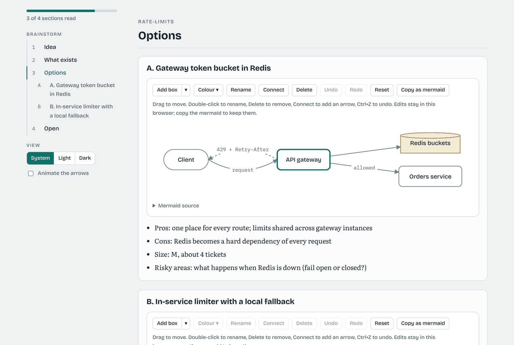

# Feature Flow

**A ticket-graph workflow for coding agents.** Works with Claude Code and Codex.

[](https://github.com/hamilton-sky/feature-flow/actions/workflows/tests.yml)

Plan a feature as a graph of small tickets, then build them in the session you are already in. One command, `/feature-flow`, does both. Every ticket is built by one fresh subagent and checked by another that never saw the builder's reasoning. A script, not the agent, decides the order of the steps, runs the build and tests, and watches for work that weakens the checks, and the whole run has limits.

One skill, 12 agent roles, a Python conductor, 6 Python scripts (`flow`, `flow-trust`, `flow-status`, `flow-view`, `gate`, `floor-guard`), an installer for both agents, a Claude Code plugin, a PyPI package, a demo and a test suite. All of it is Python (standard library only), so it runs on Linux, macOS and Windows. MIT licensed.

### At a glance

| | What you get |
|---|---|
| **Plan** | A brief you approve, a fresh planner and a fresh plan reviewer, a second yes before anything is written. An optional [brainstorm](#brainstorm-before-planning) first, shown as a review page with diagrams you can edit, or an [import](#starting-from-spec-kit-or-openspec) from Spec Kit or OpenSpec. |
| **Build** | One fresh builder per ticket, then the [gate, floor guard, footprint, Done when and test-first checks](#how-a-ticket-flows), all run by the script. |
| **Review** | A fresh reviewer that never saw the builder's reasoning, as much as the ticket's [level](#how-a-ticket-flows) asks for, and [read only](#the-skill-and-the-roles) by hook and by the conductor. |
| **Prove** | [Acceptance tests](#acceptance-tests-the-tester) written from the spec by a tester before any code, which builders cannot touch. |
| **Go faster** | [Lanes](#tickets-side-by-side-lanes) build disjoint tickets side by side, the [fast path](#the-fast-path) batches small tickets and reviews the feature once, a [time budget](#a-time-budget) switches to fast mode by itself, and [profiles](#profiles) set all of it with one word. |
| **Ask, don't guess** | [Scouts](#scouts) read ahead for every role, and [questions](#questions-for-the-architect-designer-or-product-owner) go to an architect, designer or product owner agent before they come to you. |
| **Measure** | [`feature-flow eval`](#recording-a-run-eval) records what a run cost and what each check caught, and `feature-flow report` shows the log. |

[docs/releases.md](docs/releases.md) lists what each release added.

- [Quick start](#quick-start) · [How a ticket flows](#how-a-ticket-flows) · [The skill and the roles](#the-skill-and-the-roles) · [Plans and tickets](#plans-and-tickets) · [See the graph](#see-the-graph)
- [Lanes](#tickets-side-by-side-lanes) · [Scouts](#scouts) · [codeintel](#codeintel-optional) · [Questions](#questions-for-the-architect-designer-or-product-owner) · [Acceptance tests](#acceptance-tests-the-tester) · [Fast path](#the-fast-path) · [Time budget](#a-time-budget) · [Eval](#recording-a-run-eval) · [Profiles](#profiles) · [Brainstorm](#brainstorm-before-planning) · [Import](#starting-from-spec-kit-or-openspec)
- [Long features and handoff](#long-features-and-handoff) · [Commands and settings](#commands-and-settings) · [What is tested](#what-is-tested) · [Limits](#limits) · [Upgrading](#upgrading) · [Caution](#caution)

## Quick start

You need `git` and `python3` (3.9 or later, standard library only), and Claude Code or Codex. No `bash` or `awk` is needed to run feature-flow: every script is Python. On Windows use `python` where this page says `python3`.

```bash
git clone https://github.com/hamilton-sky/feature-flow.git
cd feature-flow

python3 install.py /path/to/your/repo                  # for Claude Code
python3 install.py /path/to/your/repo --agent codex    # for Codex
python3 install.py /path/to/your/repo --agent all      # both, side by side

# `bash install.sh ...` still works on Linux and macOS: it only runs install.py
```

As a Claude Code plugin, with nothing written into your repo (this repo is its own marketplace):

```
/plugin marketplace add hamilton-sky/feature-flow
/plugin install feature-flow@feature-flow
```

The plugin carries the skills, the roles (named `feature-flow:ticket-builder` and so on), the conductor, the scripts and the guides, and the skill runs the conductor from the plugin's folder. A repo with its own install still uses that one. Claude Code cloud sessions (claude.ai/code) do not install plugins, so for them install into the repo and commit `.claude/`, `scripts/` and `.feature-flow/` as below. The plugin path is new and has not had a real run yet.

Without a clone, the same installer runs from [PyPI](https://pypi.org/project/feature-flow-cli/):

```bash
uvx feature-flow-cli install /path/to/your/repo --agent all   # or: pipx run feature-flow-cli install ...
```

The package puts a `feature-flow` command on your PATH with `install`, `uninstall`, `status <feature>`, `view <feature>`, `reset <feature>`, `report <feature>`, `eval <feature>`, `import <folder> <feature>` and `brainstorm-page <feature>`. It installs the same files, byte for byte, as `install.py` from a clone.

The installer lists what it wrote in `.feature-flow/installed.txt`, with each file's hash in `.feature-flow/installed.sha256`. Commit those files (`git add --pathspec-from-file=.feature-flow/installed.txt`); until you do, the flow does not count them as uncommitted changes. Installing a newer version over an older one updates every file nobody edited since it was installed, and keeps (and names) the ones you changed; `--force` replaces those too.

To keep the install out of git, so only your plans and tickets get committed, install with `--private`. It lists the installed files in `.git/info/exclude`, which git reads like `.gitignore` but never commits, and later installs keep that list up to date. If you already committed the install, it prints the `git rm --cached` command that untracks it and keeps the files. Every clone then needs its own install.

To remove it, run `feature-flow uninstall` (or `uvx feature-flow-cli uninstall`) in the repo. It removes exactly the files listed in `.feature-flow/installed.txt`, and only while they still hold the bytes the installer wrote: a file you edited is kept and named, and `--force` removes it too. It also drops the `--private` block from `.git/info/exclude`. Your `plans/`, your tickets and the run logs in `.feature-flow/state/` are never touched. `--dry-run` shows what would go. If you installed with `--user`, `feature-flow uninstall --user` removes the personal copy in `~/.claude` and `~/.agents`, and `~/.feature-flow`, the same way (the repo's own install is separate and needs its own `uninstall`).

Then, in your repo, in the agent:

| | Claude Code | Codex |
|---|---|---|
| Plan a feature (no plan yet) | `/feature-flow csv-export` | `$feature-flow csv-export` |
| Plan and build what you just talked through | `/feature-flow` | `$feature-flow` |
| Build its tickets (a plan exists) | `/feature-flow csv-export` | `$feature-flow csv-export` |
| The same, asking nothing | `/feature-flow csv-export auto` | `$feature-flow csv-export auto` |
| Watch the graph, animated | `/feature-flow csv-export show` | `$feature-flow csv-export show` |
| Weigh ways to build it first | `/feature-flow csv-export brainstorm` | `$feature-flow csv-export brainstorm` |
| Everyday feature (what a new plan names): two reviewers per ticket, one round review | `/feature-flow csv-export standard` | `$feature-flow csv-export standard` |
| Small, low-risk feature: one review at the end | `/feature-flow csv-export fast` | `$feature-flow csv-export fast` |
| Costly to get wrong: full gate, own review per ticket | `/feature-flow csv-export careful` | `$feature-flow csv-export careful` |
| Another agent drives the session, no handoffs | `/feature-flow csv-export agent` | `$feature-flow csv-export agent` |

The same command plans when `plans/csv-export/` does not exist yet and builds when it does. After your second yes it commits the new plan folder, and only that folder, then goes straight on to building it; say so if you want it to stop after planning.

**Planning asks you twice.** First the session shows a short feature brief, written from your conversation (what, why, scope, the bar, and anything it had to assume), and waits for yes, edit or cancel. Then a fresh `feature-planner` subagent, given only that brief, reads the code, looks up outside docs where the code cannot answer, and writes a draft plan into the git-ignored `.feature-flow/state/draft/`. The planner folds changes too small to stand alone into the ticket they belong to, and gives every ticket a level (1 light, 2 standard, 3 boundary) that decides how much review it gets. A fresh `plan-reviewer` checks the draft against the brief. The session shows you the goal, the commands, the ticket graph, what was dropped and the review result, and waits for a second yes. Only then does `flow.py plan-accept` copy the draft into `plans/<feature>/`, and the session commits it and starts the build.

Try the graph first, with no setup and no agent: `bash examples/demo.sh --open`.

### Two ways to install

- `feature-flow install --user`: once, for every repo. Skills and roles go to `~/.claude` / `~/.agents`, the conductor, guides and package to `~/.feature-flow/`. `FEATURE_FLOW_HOME` moves that folder. No repo files are written.
- `feature-flow install <repo>`: one repo. When a repo has its own copy, that copy wins over the user install.

### What the installer does

| | Claude Code (`--agent claude`, the default) | Codex (`--agent codex`) |
|---|---|---|
| The skill goes to | `<repo>/.claude/skills/` (`--user`: `~/.claude/skills/`) | `<repo>/.agents/skills/` (`--user`: `~/.agents/skills/`) |
| Roles go to | `<repo>/.claude/agents/` | `<repo>/.agents/flow-roles/`, put in front of each subagent's prompt |
| Scripts go to | `<repo>/scripts/` | `<repo>/scripts/` |
| Guides, roles and the conductor go to | `<repo>/.feature-flow/` | `<repo>/.feature-flow/` |

Next to the `feature-flow` skill it installs `architect-review` and `automation-design`. The installer never deletes anything. A file that already exists and differs is kept and reported; `--force` replaces it. `--dry-run` shows what would change and writes nothing. `CLAUDE_HOME` and `AGENTS_HOME` move the user folders. With `--user` the skill and roles go to the user folders, and the scripts, guides, conductor and package go to `~/.feature-flow/` (`FEATURE_FLOW_HOME` moves it); nothing is written into a repo.

The Claude Code skill is `skills/feature-flow/`. The Codex skill is written by hand in `adapters/codex/feature-flow/`, with an `agents/openai.yaml` that sets `allow_implicit_invocation: false`, so it runs only when you name it. The steps are the same; only the way a subagent is started differs. Your own `AGENTS.md` and `CLAUDE.md` are never touched.

## How a ticket flows

```
 tester subagent (once, before the first ticket, when commands.md
   has Acceptance:): writes acceptance tests from spec.md only
        │
        ▼
 smoke command (script): is the base healthy?   no ─► stop, spend nothing
        │ yes
        ▼
 pick ticket ─► builder subagent: claim, build, prove it (run fresh, read the output), commit
                                              │
                                              ▼
 gate (script):  Build, Test, Lint from commands.md           fail ─┐
                                              │ pass                │
                                              ▼                     │
 floor guard (script, no AI):                                       │
   tests skipped or deleted? checks silenced? empty catches?        │
   thresholds lowered? lint/test/CI config edited?             fail ─┤
   plan touched beyond own Status + Answer + appended lines?        │
                                              │ clean               │
                                              ▼                     │
 footprint (script): only the paths on the ticket's Touches:  fail ─┤
                                              │ pass                │
                                              ▼                     │
 Done when checks (script): runs every ```check block          fail ─┤
 test-first check (script): Test first: yes needs a test-only        │
   commit that failed Test before the code                     fail ─┤
                                              │ pass                │
                                              ▼                     │
 review: one fresh reviewer subagent, sees only the ticket         │
 + diff: the spec checklist, then the code's quality; at level 3     │
 it also probes every input as a hostile caller               FAIL ─┤
                                              │ PASS                ▼
                                              ▼        findings written into the ticket,
                                     next ticket       reopened, built again (rounds by level);
                                                       the builder's prompt then carries
                                                       a root-cause debugging guide

 every ticket resolved: the acceptance tests run (script)     fail ─► fix ticket, built and
                                                                      reviewed like any other
```

`scripts/flow.py` is the conductor. The session asks it `next`, and it answers with one line: `TEST`, `BUILD`, `REVIEW`, `ASK`, `DONE`, `STOP` or `HANDOFF`. It prints the full prompt for each subagent from runtime-neutral guides, so the session never writes one itself.

**What the script checks and what it trusts.** The conductor verifies the build from the repo: the ticket file must say `resolved`, the tree must be clean and committed, and it runs the gate and the floor guard itself. It also runs the `check` block under each ticket's Done when and compares the exit code and printed text (a check with a `needs <what>` line, such as `needs network`, that fails is deferred instead: the reviewer is told it is not met, and it goes to `followups.md`), and for a `Test first: yes` ticket it proves the red test commit itself: it checks out the test-only commit, runs Test, and requires it to fail before the code. A failure of either goes back to the builder before any reviewer is started. It also checks that the reviewer changed no tracked file and made no commit (an edit is put back and the review given to a fresh reviewer, see Read only roles below). The review verdicts are different: each reviewer's reply is relayed by the session, which saves it to a file and hands it to `flow.py verdict`. The script reads `REVIEW: PASS` or `REVIEW: FAIL` from that reply; it cannot prove the session passed it on unedited. A ticket with a `Level:` line moves on after one PASS verdict. A ticket with no level (a plan from before 0.9.0) needs two, a spec review and then a quality review, unless the conductor judged it small. The size is measured from the repo (`git diff` against the commit the ticket started from), never taken from the builder.

**The gate: full or quick.** The gate runs Build, Test and Lint after every ticket. With an optional `Quick:` line in `commands.md` (a faster subset of `Test`), it runs Build, Quick and Lint after the tickets in the middle of a plan, and the full Build, Test and Lint after the last ticket, before a handoff, and under `FLOW_GATE_FULL=1`. A plan without `Quick:` runs the full gate every time. The test-first proof still runs the full `Test` command.

**Ticket levels.** The planner writes `Level: 1`, `2` or `3` in each ticket, the plan reviewer checks it against written rules, and you approve it with the plan.

| | Level 1 (light) | Level 2 (standard) | Level 3 (boundary) |
|---|---|---|---|
| For | tests, docs, prompt text, spikes, the acceptance ticket | ordinary feature code | auth, tokens, permissions, money and run limits, data loss, the flow's own code, anything a hostile caller reaches |
| Reviews | one combined review | one combined review, spec checklist first | one combined review that also probes every input as a hostile caller |
| Rework rounds | 1, then the run stops for you | 2; from round 3 only a `blocker` sends it back, majors go to `plans/<feature>/followups.md` and the ticket passes | `FLOW_MAX_REVIEW_ROUNDS` (3), then the run stops for you |

The gate does not depend on the level: it still runs Quick mid-plan and the full Test on the last ticket and before a handoff. Nobody but you can lower a level. The conductor reads `Level:` from the ticket as it was at the base commit, so a builder's edit does nothing (and the floor guard fails it). It raises the level from what it measures, never lowers it: `Review: full`, `Type: convert` and `Floor: allow flow-edit` make a ticket level 3, so does a diff that touches a path on the optional `Sensitive:` line of `commands.md` (frozen by the floor guard), and a level 1 diff over the small limits becomes level 2. A reviewer can raise it with a line `LEVEL: 3` above the verdict; a raise to 3 during a combined review adds a quality review. The log records `LEVEL-1`, `LEVEL-2` or `LEVEL-3` for each review round, and `feature-flow report` shows it.

**One review at level 3 too (0.23.0).** Before 0.23.0 a level 3 ticket got a spec review and then a separate quality review. In the first field run (two features, 19 separate spec reviews), every real catch came from the quality review: the spec review re-ran the Done when checks the conductor had already run and passed, and found nothing they had missed. So a level 3 ticket now gets one review, which does the spec checklist (marking bullets the conductor's check block covered as `MET (conductor)` instead of running them again) and then the quality review with the hostile caller probe. That saves a fresh reviewer per level 3 ticket. A reviewer that raises a ticket to level 3 in a combined review still adds a quality review after it, since it did not probe the change as level 3.

**One review for a small ticket (no level).** A ticket with no `Level:` line, from a plan written before 0.9.0, keeps the 0.8.0 rules. A ticket whose built diff is 3 files and 60 changed lines at most (the plan folder left out), and whose `check` block ran and passed, gets one combined review instead of the spec and quality reviews. The conductor measures the diff itself. `Review: full` in the ticket (as it was at the start), `Type: convert`, no `check` block, or `FLOW_GATE=off` keep both reviews. Every other conductor check still runs on every ticket.

## The skill and the roles

| Skill | What it does |
|---|---|
| `feature-flow` | **Plan:** turns the conversation (or your answers) into a feature brief and waits for a yes, has a planner and a plan reviewer subagent draft and check `plans/<feature>/` (a spec, a map, commands, learnings and tickets), shows you the graph, and writes it after a second yes. **Build:** runs the tickets one by one, a builder and a reviewer subagent each, with `flow.py` deciding every step. **Show:** the animated ticket graph and a summary of what is ready and what blocks the finish. |
| `architect-review` | Architecture review of a file, diff or feature, with severity rated findings. Reads `CLAUDE.md` or `AGENTS.md` for the project's own rules. |
| `automation-design` | Blueprint for an automation pipeline. Hands off to `feature-flow` for the plan. |

| Role | Tools | Job |
|---|---|---|
| `ticket-builder` | Read, Glob, Grep, Edit, Write, Bash | Builds one ticket (or, in fast mode, a batch of small ones) by the build guide in its prompt. |
| `ticket-reviewer` | Read, Glob, Grep, Bash (no Edit, no Write) | Reviews one ticket, or the whole feature on the fast path, by the review guide in its prompt and ends with `REVIEW: PASS`, `REVIEW: FAIL` or `REVIEW: ASK <role>`. |
| `feature-planner` | Read, Glob, Grep, Bash, Write, WebSearch, WebFetch | Plans one feature from the approved brief by the plan guide, writes only the draft, cites outside sources, and ends with `PLAN: READY` or `PLAN: QUESTIONS`. Also folds open tickets on a re-plan. |
| `plan-reviewer` | Read, Glob, Grep, Bash (no Edit, no Write) | Checks the draft against the brief by the plan review guide and ends with `PLAN-REVIEW: PASS` or `PLAN-REVIEW: FAIL`. |
| `flow-tester` | Read, Glob, Grep, Edit, Write, Bash | Writes the feature's acceptance tests from `spec.md` alone, before the build, by the test guide. Never reads the tickets. |
| `flow-scout` | Read, Glob, Grep, Bash (no Edit, no Write), Haiku | Reads the code ahead of a planner, builder, reviewer or consultant and reports what it found. Decides nothing. |
| `flow-web` | WebSearch, WebFetch, Haiku | Looks up outside facts for the planner or a brainstorm, with sources. |
| `flow-architect`, `flow-designer`, `flow-po` | Read, Glob, Grep, Bash (no Edit, no Write) | Answer one technical, UI or product question a builder, reviewer or planner asked, or (`flow-po`) rule on a disputed acceptance test. |
| `flow-skeptic` | Read, Glob, Grep, Bash (no Edit, no Write) | Attacks each option a brainstorm drafted: one objection and one hidden cost each. |
| `flow-lens` | Read, Glob, Grep, Bash (no Edit, no Write) | Looks at a brainstorm's options through one lens (`positive`, `researcher`, `open-minded`, `artistic`, `ux`, `security`) and reports what it sees. |

**Read only roles.** The reviewers, the consultants (`flow-architect`, `flow-designer`, `flow-po`), the brainstorm helpers (`flow-skeptic`, `flow-lens`) and `flow-scout` have no Edit or Write tool, and in Claude Code a `PreToolUse` hook in their role file blocks shell commands that change files or the repository: git commands that write (`commit`, `add`, `stash`, `checkout`, `reset` and the like), `sed -i`, `rm`, `mv`, `cp`, `touch`, `tee` and output redirected into a file other than `/dev/null` or `/tmp/`. The hook reads the command's text, so a program that writes files itself (a test runner updating snapshots, a script) still gets through, and Claude Code ignores hooks in a plugin's agents. A Codex subagent cannot be limited at all: Codex gives every child its parent's sandbox. So the conductor is the backstop everywhere: when a reviewer or consultant leaves a tracked file changed, it saves the change as `.feature-flow/state/edit-<feature>-<NN>.patch`, puts the files back, throws that answer away and hands the same review to a fresh reviewer, with a note saying why (`EDIT-UNDONE` in the log). A second edit in a row stops the run, and so does a commit, which it cannot undo safely. A planner's draft reaches `plans/` only through `plan-accept`. On Codex the planner can research the web only if web search is on; otherwise it plans from the code and says so. The Codex planning path has not been run by hand.

The guides in `guides/` (installed to `.feature-flow/guides/`) hold the protocol: how to build, review, write the brief, plan, review a plan and show. The skill holds only what differs per agent.

## Plans and tickets

```
plans/
└── csv-export/
    ├── spec.md          what and why
    ├── map.md           destination, the bar, decisions so far     (workers append only)
    ├── commands.md      build, test, lint, smoke commands           (frozen once approved)
    ├── learnings.md     traps workers found                         (workers append only)
    ├── brainstorm.md    the options weighed and the one picked      (only after a brainstorm)
    └── tasks/
        ├── 01-types.md
        ├── 02-service.md
        └── 03-acceptance.md
```

`commands.md` and `learnings.md` are separate from the map because they follow different rules. Commands are approved by a human and read by the scripts, so they are frozen. Learnings grow with every ticket, so they are append only and a human prunes them (`--check` warns past 40 lines). The map stays short.

The lines `commands.md` can hold ([template](guides/templates/commands.md)); delete the ones you do not need:

| Line | Needed | What reads it |
|---|---|---|
| `Build:`, `Test:`, `Lint:` | yes (`Test:` at least) | the gate, after every ticket |
| `Smoke:` | yes | run before every ticket; the run stops if it fails |
| `Quick:` | no | a fast subset of Test for the tickets in the middle of a plan |
| `Run:` | no | how to start what the feature builds |
| `Acceptance:` | no | turns on the [tester](#acceptance-tests-the-tester); runs only `plans/<feature>/acceptance/` |
| `Sensitive:` | no | paths that make any ticket touching them level 3 |
| `Shared:`, `Setup:` | no | for [lanes](#tickets-side-by-side-lanes): paths that keep a ticket alone, and what a fresh worktree needs |
| `Profile:` | no | `careful`, `standard`, `normal` or `fast` for this plan ([profiles](#profiles)); a new plan's template says `standard` |

One markdown file per ticket in `plans/<feature>/tasks/NN-slug.md`:

````
# Add the retry policy to the job runner

Type: task                 task | settle | convert
Status: open               open | claimed | resolved | parked
Blocked by: 01, 02         or —
Test first: yes            yes | no
Level: 2                   1 light | 2 standard | 3 boundary
Touches: src/export/       the paths it changes; a build outside them goes back
Floor: allow config        optional, only when a human decides the guard may let it through

...what to do and why...

## Not in this ticket
## Done when                 commands and the results they print
```check
$ python3 -m unittest discover -s tests/py
exit 0
prints OK
```
## Reference
## Answer                    Built, Proof, Decisions, Shortcuts taken, Review fixes, For later tickets
````

- **Order comes from `Blocked by`**, not from numbers. A ticket is *ready* when it is open and every ticket it is blocked by is resolved. Lowest number wins.
- **Status lives only in the ticket files.** `map.md` never repeats it.
- **The Answers are the handoff between subagents.** The next builder reads the Answers of the tickets it depends on.
- `settle` tickets record a decision. `convert` tickets migrate something and must be safe to run twice.
- **A worker may change only** its own Status line and Answer, lines appended to `map.md` and `learnings.md`, and the code the ticket calls for. Rewriting its own Done when, editing another ticket, or touching `commands.md` fails the guard.
- `Floor:` categories: `skip`, `suppress`, `empty-catch`, `test-delete`, `threshold`, `trivial-assert` (an assertion that cannot fail, added to a test file: `assert True`, `assertEqual(x, x)`, `expect(v).toBe(v)`), `config`, `ticket-edit`, `commands-edit`, and `flow-edit` (allows the conductor's code check below, for the build only). `skip` covers skipped, expected-fail and focused tests (`.only(`, `fit(`, `fdescribe(` on test paths); `config` covers more lint and test config files, the lint and test sections of `pyproject.toml` and `setup.cfg`, scripts and test keys in `package.json`, new skip or xfail words in `conftest.py`, and a `Makefile` only when `commands.md` uses `make`. A test file that loses assertions is shown to the reviewer as a warning, not a finding. The line is read from the ticket as it was before the work started, so a worker cannot excuse itself.
- The guard needs the plan to be tracked by git. If you keep tickets in an ignored folder, it cannot see changes to them.
- The commands in `commands.md` run with nobody watching and must exit non zero on failure.

## See the graph


*The page `flow-view` writes, shown for the demo plan from `examples/demo.sh`: resolved tickets in green, ready ones in amber, the one being worked in blue, the rest waiting. Press Replay to watch the run back from git history.*

```bash
python3 scripts/flow-view.py csv-export            write the page and open it (or: feature-flow view csv-export)
python3 scripts/flow-view.py csv-export --watch    keep it updating while tickets are built
bash examples/demo.sh --open                    try it on a made up project, no setup needed
```

One self contained HTML file: no server, no libraries, no network, light and dark. It is written to `.git/flow-<feature>.html`, so it never dirties the tree (`--out FILE` writes it elsewhere).

```
  01 types ──► 02 service ──► 04 acceptance        ● resolved  ◉ ready (pulses)
        └────► 03 wire ──────────┘                 ◌ being worked (spins)  ○ waiting
  ▶ replay ──●──────●─────○──────────   drag to scrub through the run
```

- **Layered left to right**, so the order of work is visible. Dashes flow along the edges into tickets that are ready to start.
- **Replay** plays the run back from git history: tickets turn green in the order they resolved, and a ticket sent back by the gate, the guard or the reviewer flashes red.
- **Hover or click** a ticket for its blockers, Done when, Answer, and the rounds it was sent back.
- **Keys:** space plays or pauses, the arrows step, End shows now, `t` switches theme. Reduced motion is respected.
- **Safe by construction:** ticket text comes from files an agent wrote, so it is escaped when embedded and only ever inserted as text.
- `flow-status.py <feature> --json` prints the same data for other tools. Mermaid (`--mermaid`) remains the choice for pull requests, because GitHub renders it.

## Tickets side by side (lanes)

With `FLOW_LANES=2` (up to 4) on `start`, tickets that do not touch the same files are built at the same time, each with its own builder and reviewers in its own git worktree. Only the start and the end of a ticket change: the build, the gate, the floor guard and the reviews are the same as with one lane.

- **Plan.** Each ticket lists the paths it changes on a `Touches:` line (a folder ends with `/`, a `*` glob crosses folders). `commands.md` may name `Shared:` paths that many tickets change, and a `Setup:` command a fresh checkout needs. The plan reviewer checks the footprints; you approve them with the plan.
- **Schedule.** The conductor leases a ready ticket to a free lane only when its `Touches:` (read from the feature branch, never from a builder) does not overlap any running ticket's, it touches nothing on `Shared:`, and, when either ticket is level 3, the two keep to different top-level folders. A ticket with no `Touches:` line runs alone.
- **Lanes.** The lanes are worktrees in `.feature-flow/lanes/<feature>/` (git ignores the folder), created on first use, with `Setup:` run once in each. Each ticket gets a branch `ff/<feature>/<NN>` from the feature head.
- **Footprint check.** After every build, with or without lanes, a change to a path outside the ticket's `Touches:` sends the ticket back (`FOOTPRINT-FAIL` in the log).
- **Merge.** A ticket that passes its review is merged by the conductor, one at a time, in `.feature-flow/lanes/<feature>/integrate` with `git merge --no-ff`, so the reviewed commits land unchanged. The gate runs on the merge (Quick mid-plan, the full Test for the last ticket). Only a green merge fast-forwards the feature branch; then the ticket's branch is deleted with `git branch -d`. When two lanes both appended to `map.md`, `learnings.md` or `followups.md`, the conductor keeps both sides' lines; no agent ever resolves a conflict.
- **Rebuild.** Any other conflict, or a gate that fails on the merge, sends the ticket back to be built again from the feature branch as it is now, with what went wrong and its earlier commit in the ticket. A second collision stops the run for you: the plan's `Touches:` are likely wrong.
- **Level 3.** When another ticket merged after a level 3 ticket started, it is merged with the new feature head in its lane, gated, and given its quality review again before it merges.
- **The end.** After the last merge the lanes are removed. `reset` removes them too, with the ticket branches.

The session runs `prompt`, `next` and `verdict` with the lane from the `BUILD` or `REVIEW` line, and `next` answers `WAIT <lanes>` when every lane that can work is busy (see `## Lanes` in the skill).

## Scouts

Before a planner, builder or reviewer starts, the session can spawn cheap helpers that read ahead for it: `flow-scout` (read only, codebase) and `flow-web` (web only, for the planner). Both run on Haiku in Claude Code (`model: haiku` in their role files); in Codex the skill picks the lightest model `spawn_agent` allows. A scout looks at the code the way its role would (`ROLE: builder` looks for patterns and helpers to reuse, `ROLE: reviewer` for the rules the change must follow) and never decides anything.

| Before | Scouts |
|---|---|
| planning (`plan-scouts <brief>`) | one codebase scout and one web scout |
| a level 1 ticket | none |
| a build below level 3 (first attempt) | one builder scout on the ticket and its `Touches:` |
| a level 3 build (first attempt) | two builder scouts: the code it changes, and what depends on it |
| a level 3 ticket's first review | one reviewer scout on the conventions the diff must follow |
| the feature review (fast path) | one reviewer scout |

`scouts [lane]` lists `SCOUT <k> <agent> <reply file>` lines (or `NONE`) and clears the last ones' replies; `scout-prompt <k> [lane]` prints one scout's prompt. The session saves each reply into its file, and the phase's `prompt` adds them under `## Scout findings (unverified)`, cut to 60 lines each. A reply saved for one phase never reaches another. Retries and later rounds get no scouts. `FLOW_SCOUTS=off` turns them off.

## codeintel (optional)

[codeintel](https://github.com/hamilton-sky/codeintel) is a separate code-intelligence tool: one command answers who calls a function, what a change would break, or where the code that does something lives, from a call graph, a language server and semantic search. feature-flow never needs it. When it is installed and has the repository indexed, two roles get a short `## codeintel` section in their prompt:

- **Scouts** (`flow-scout`, not `flow-web`) are told to ask it `callers`, `impact` or `search` where grep would take several tries.
- **Reviewers** (every ticket review and the feature review) are told to run `codeintel query --op changed --target <base>`, which lists each function the change removed, re-signed or rewrote with the callers it did not update.

Each of them ends its reply with one line per question, `codeintel: <op> <target>: helped | no answer | wrong: <why>`, and is told to check an answer before relying on it and to fall back to grep. `eval` counts the queries and those lines, and the verdict form asks whether codeintel helped, made no difference or misled the run, with a line for an answer it got wrong: material for a codeintel issue.

To set it up: `pip install "feature-flow-cli[codeintel]"` (or `pip install codecortex`), then `codeintel setup --all .` in the repository. feature-flow asks `codeintel doctor --json` which engines are ready and keeps the answer for an hour in `.feature-flow/state/codeintel.json`; with nothing ready, or no `codeintel` on PATH, the prompts are as before. `FLOW_CODEINTEL=off` leaves it out. In a lane, the agents run it in the lane's worktree, where codeintel may not have an index, and then fall back to grep. The two tools are released on their own and neither imports the other.

## Questions for the architect, designer or product owner

A builder, reviewer or planner that hits a question it should not decide alone asks it instead of guessing, and the flow pauses that job until the right role answers.

- **Who answers.** `flow-architect` answers technical design questions, `flow-designer` answers UI and UX questions, and `flow-po` answers what the feature must do where the spec is silent. Each is a fresh, read only agent that sees the plan, the ticket as it was planned and the code, never the asker's reasoning or a ticket's Answer. Each gets one scout with its own lens first.
- **A builder** appends `## Ask: architect|designer|po` with the question to its ticket and stops. `next` hands out `ASK <role> <ticket> <NN> <sha>`. The answer goes into the ticket under `## Consulted (<role>)`, and the ticket is built again. The question does not count as a failed attempt.
- **A reviewer** ends with a `## Question` and `REVIEW: ASK <role>`. The answer comes back in the next review's notes. On the fast path's feature review, the reviewer writes the question as a finding, and the fix ticket's builder can ask it.
- **The planner** starts each open question with `architect:`, `designer:`, `po:` or `user:`. The session runs `consult-prompt <role> <question file>` for the first three, adds the answers to the brief under `Consulted:`, kept apart from your `Decided:` lines, and plans again.
- **A question for you goes to the product owner first.** A builder's or reviewer's question marked `user` is sent to `flow-po` once per ticket. The architect, designer and product owner decide what the spec leaves open; only scope, cost and steps outside the repo come to you.
- **`plans/<feature>/decisions.md`** keeps every answer: the ticket, who asked, which role answered, the question, the answer and the role's `## Why`, committed with the ticket (`DECISION` in the log).
- **What still comes to you.** Any question the product owner sends on with `ANSWER: USER`, any answer a consultant ends with `ANSWER: USER` (it changes what you get, so its options come to you), and a third consultant question on one ticket all stop the run with the question, written into the ticket under `## Ask: user`. You answer under `## Consulted (user)` at the end of the ticket, commit, and run `next`. A reviewer's question for you reopens the ticket, so its builder builds again with your answer.

## Acceptance tests (the tester)

A builder writes its own tests, so they tend to check what it built rather than what was asked. With an `Acceptance:` line in `commands.md` (the planner writes one for any feature a test can reach from outside), a separate tester writes the feature's acceptance tests before any of it is built, from the product owner's words alone.

- **Before the first ticket**, `next` hands out `TEST <plan folder> <sha>`. A fresh `flow-tester` reads `spec.md` (its bar, stories and acceptance criteria, edge cases and interfaces), `map.md`, `commands.md` and the existing code's conventions, never the tickets, and commits tests under `plans/<feature>/acceptance/` that only the `Acceptance:` command runs. The conductor then checks its work: the commits change nothing outside that folder, the gate still passes with the tests in place, and the tests fail now, since nothing is built yet (`TEST-WRITTEN` in the log). Otherwise a fresh tester gets the job again, with a note saying what was wrong. It has no lane, even when lanes run.
- **Builders cannot change them.** The tests sit inside the plan folder, so the floor guard fails any builder's change there (`acceptance-edit`), and no `Floor:` line allows it. A builder may run them to see where the feature stands.
- **Once every ticket is resolved**, the conductor runs the `Acceptance:` command itself (`ACCEPT-PASS` or `ACCEPT-FAIL`). A failure becomes a new ticket, `NN-acceptance-fixes-<round>.md`, with the failing output in it, built and reviewed like any other; then the tests run again. After `FLOW_MAX_REVIEW_ROUNDS` failed rounds the run stops for you. With the fast path, the tests run before the feature review.
- **A disputed test.** The tester can be wrong too, most often where the spec is vague. A fix ticket's builder that is sure a test asks for something `spec.md` does not say asks the product owner with `## Ask: po`. `flow-po` rules from `spec.md` alone with `RULING: TEST WRONG` or `RULING: CODE WRONG` (`RULING-TEST` or `RULING-CODE` in the log). The builder leaves a test ruled wrong failing and finishes the rest; once the ticket is resolved, a tester changes exactly the tests ruled wrong, as the rulings say, and the tests run again. The usual limit on questions holds, so a third one goes to you.
- **No `Acceptance:` line, no tester**: a plan written before 0.23.0 runs as before.

## The fast path

`/feature-flow <feature> fast` trades per-ticket reviews for speed. The planner gets `Pace: fast` in the brief and writes a short plan of fewer, larger tickets, and the plan reviewer is skipped. With `FLOW_FAST=1` on `start`, a ticket below level 3 (one with no `Level:` line too) that passes the gate, the floor guard and its Done when checks passes at once (`REVIEW-DEFERRED` in the log). With `FLOW_GATE=off` nothing would check it, so every ticket keeps its review. A level 3 ticket, or one that touches a `Sensitive:` path, still gets its own reviews.

- **The feature review.** Once every ticket is resolved, `next` hands out `REVIEW <plan folder> all <sha>`: one fresh reviewer reads the deferred tickets as they were planned and the whole diff from the oldest deferred ticket's base to HEAD, with `guides/review-feature.md`. It has no lane, even when lanes run.
- **A failed feature review** becomes a new ticket, `NN-feature-review-fixes-<round>.md`, with the findings in it. A builder fixes it, and the feature is reviewed again. After `FLOW_MAX_REVIEW_ROUNDS` failed rounds the run stops for you.
- **Batches.** In fast mode one builder takes up to 5 ready tickets at once (`BATCH <n>` in the log), when each is level 1 or 2, has a `Touches:` line, and touches nothing another ticket of the batch or a `Sensitive:` path touches. The `BUILD` line names the first ticket and the prompt lists the rest. The builder finishes them one at a time, each with its own commits. The conductor then checks each ticket on its own commits: the gate once at the end (and, if it fails there, at each ticket's last commit, to find the first one that broke it), then the floor guard, the footprint, Done when and test first with HEAD at that ticket's last commit. A ticket that passes is deferred to the feature review like any other. One that fails, or that the builder never finished, goes back to open with its findings and is built alone (`BATCH-FAIL`), never in a batch again. That saves a builder and its context for every ticket but the first. A mistake in one ticket can still carry into the later ones of the batch, which is why only small, separate tickets are batched. Lanes, `FLOW_RELAY` and `FLOW_GATE=off` turn batches off, and so does `FLOW_BATCH=1` (`FLOW_BATCH=<n>` sets the size, at most 5).
- **Mid-run.** `fast on` and `fast off` (through the runner, like `next`) switch it between phases. Asking the session to go faster runs `fast on`. Asking again while fast is on offers the re-plan below. Tickets already passed without a review still get the feature review, whichever way it is switched.
- **The cost.** A mistake in an early ticket is found at the end, when later tickets may have built on it. Use it for small or low-risk features. `reset` keeps the list of deferred tickets, so they still get the feature review.

## A time budget

`FLOW_BUDGET=<minutes>` on `start` gives the feature a budget of active minutes. The conductor counts the time between its steps, at most an hour for one step, so a session left open overnight does not eat the budget, and the time between two sessions does not count. `budget` (through the runner) reports it, and `budget <minutes>`, `budget +<minutes>` or `budget off` change it between phases.

- **Over the budget, fast mode first.** Before the next ticket starts, the conductor turns fast mode on by itself (`BUDGET-FAST` in the log).
- **Still over, a re-plan offer.** Once fast mode has finished a ticket and the run is still over (or at once, if fast mode was already on), the run stops once with the minutes spent, the tickets left, and an offer to re-plan. If one ticket took more than half the time over several attempts, the stop names it as stuck, since that is a stuck ticket, not a slow plan. `next` goes on as planned, and a new `budget` earns a new offer.
- **The re-plan needs your yes.** On your yes, between tickets, `replan-prompt` hands the `feature-planner` the open tickets with `guides/replan.md`. It folds them into fewer, larger tickets with the same bar: every Done when item and check moves into the ticket that takes over, folded tickets become `Status: parked (folded into NN)`, and resolved tickets stay as they are. The session shows you the change and commits it only on a second yes. The next `next` stops if the re-plan changed a resolved ticket. Nothing is ever cut without you.

## Recording a run (eval)

Every finished run can leave a record of what it cost and what it caught, so a trial on your own repo gives an answer, not an impression. On `DONE` the skill runs `python3 scripts/flow-status.py <feature> --eval` (or run `feature-flow eval <feature>` yourself) and asks you a few questions.

- **`plans/<feature>/eval.json`**: tickets, builds, reviews and rework; tickets settled when the plan was approved and never built; every catch by the check that made it (gate, floor guard, Done when, test first, footprint, reviewer, feature review); the follow-ups in `followups.md` and the deferred checks; who drove the run (`driver`: `person` or `agent`); where the run needed its driver (stops, questions, handoffs, resets); active minutes; and tokens.
- **`plans/<feature>/followups.md`**: what the run left for later, committed as it goes: the `minor` findings of every passing review, the findings a level 2 ticket passed with after its full rounds, and each `needs` check (below) that could not pass on this host.
- **Tokens** come from Claude Code's own session transcripts (`~/.claude/projects/`, or `CLAUDE_CONFIG_DIR`), never from the agent: every message of the sessions and subagents that worked in this repo during the run, each counted once, by model and, without lanes, split per ticket by time. Codex sessions are not read yet.
- **codeintel**: when an agent asked [codeintel](#codeintel-optional), `codeintel` in `eval.json` counts the queries by op and what the agents said of the answers (helped, no answer, wrong, and why), and the form below asks whether it helped.
- **`plans/<feature>/eval-verdict.md`**: a form for you. Was the plan right, how many fixes you made by hand, would you use it again, and for each catch whether it was real or a false alarm. Run `--eval` again and your answers land in `eval.json`. The false-alarm count is the only way to tell whether the checks are worth their cost.
- **Timing**: `timing` in `eval.json` gives the wall clock, the minutes by phase, by ticket and by level, the slowest ticket and how many times the whole `Test` ran. `feature-flow eval <feature> --compare <eval.json> ...` puts several runs side by side.
- **Later:** `feature-flow eval <feature> --later`, a week or two on, lists the commits since the run whose subject says fix, revert, bug or regression on the paths each ticket's `Touches:` names: the defects the run let through.

Both files sit in the plan folder, so they are committed with it and survive a cloud session. Nothing is sent anywhere; attach `eval.json` to a field-run issue if you want to share it. Run logs from before 0.15.0 have no dates, so they give no tokens.

## Profiles

Most settings below never need touching. One word picks a sensible set:

| Profile | Sets | For |
|---|---|---|
| `careful` | `FLOW_GATE_FULL=1`, `FLOW_REVIEWERS=2`, `FLOW_ROUND_REVIEW=on`, `FLOW_BASE_GATE=on`, `FLOW_FAST=0`, `FLOW_SMALL_LINES=0`, `FLOW_TICKETS_PER_SESSION=3` | code where a wrong "done" is expensive: the full gate and an own review for every ticket |
| `standard` | `FLOW_REVIEWERS=2`, `FLOW_ROUND_REVIEW=on`, `FLOW_BASE_GATE=on` | everyday features, and what a new plan's `commands.md` names: slower than `fast`, faster than `careful` |
| `normal` | nothing: the defaults | plans written before 0.30.0 |
| `fast` | `FLOW_FAST=1`, `FLOW_SCOUTS=off`, `FLOW_TICKETS_PER_SESSION=6` | small, low-risk features: one feature review at the end |

**What `standard` does.** The gate runs once at the base before the first ticket, so a red base stops the run before a builder is blamed for it. Where one review would run, a quality reviewer and a ticket reviewer read the ticket side by side, both read only, in one subagent call each (`REVIEW <ticket> ... pair`); the session sends both replies to `verdict` and the conductor keeps the worse. On a level 1 or 2 ticket only a blocker sends the ticket back to its own builder; smaller findings go to `followups.md`, which later tickets' builders read. With an `Acceptance:` line the tester's tests run after each ticket and their output goes to the reviewers. Once every ticket is done, one more reviewer reads the whole round's diff against the plan. Level 3 and `Sensitive:` tickets keep their full own reviews.

Pick one with `/feature-flow <feature> careful` (or `standard`, `fast`), `FLOW_PROFILE=<name>` on `start`, or a `Profile:` line in the plan's `commands.md`, approved with the plan. A profile fills only settings you did not set: `FLOW_PROFILE=fast FLOW_SCOUTS=on` keeps the scouts. The log records `PROFILE-<NAME>` at the start. A level 3 or `Sensitive:` ticket keeps its own reviews in every profile.

The long `python3 -I -c ...` line the skill uses to call the conductor stays as it is: it is how the skill checks `flow-trust.py` against the sha256 it pins before running it, and a shorter wrapper would be one more file nothing checks. The session copies it from the skill; you never type it.

## Brainstorm before planning

When an idea is still fuzzy, the session can brainstorm it with you before it writes the brief: `/feature-flow <feature> brainstorm`, always in `careful`, and offered on its own when there is no bar yet or there are two real ways to build it. It asks you up to three questions, one at a time, sends a scout to see how the code does the nearest thing today, then lays out two or three options, each with a mermaid diagram, its pros and cons, its size and its risky areas, and recommends one. Your pick and the brief share one yes.

Read only helpers work for the session during a brainstorm: a code scout, a web scout, the architect, designer and product owner, `flow-skeptic`, who attacks each finished option so the session that wrote the options is not the one that judges them, and `flow-lens`, who looks at the options through one lens the session picks for the idea: `positive`, `researcher`, `open-minded`, `artistic`, `ux` or `security` ([guides/lenses/](guides/lenses/)). Each gets its prompt from `brainstorm-prompt <helper> <question file>`, which counts them: `normal` allows 2 scouts, 1 web, 2 consultants, 1 skeptic and 2 lenses per brainstorm, `careful` 3, 2, 3, 1 and 3, and `FLOW_SCOUTS=off` no scouts. Helpers never write the brainstorm and never ask you anything; the session does both.

Before you pick, the session shows the brainstorm as a review page: `feature-flow brainstorm-page <feature>` (or `flow-status.py <feature> --brainstorm-page`) writes it beside the brainstorm as one HTML file. It has a sidebar that routes between the sections and shows how far you read, a system, light or dark switch, flowchart diagrams you can edit (arrange them left to right, top to bottom, radial or as a grid, drag, add boxes of seven kinds, colour them from 12 colours, rename and delete them, connect them with arrows, undo and redo, with the keyboard too), reset, and copy back as mermaid (the edited diagram once you change it; edits are kept only in that browser), and an arrow animation that stays off until you turn it on. Its look is a style: `route` (the default), `blueprint`, `sketch`, `paper`, `terminal` or `bright`, picked with `--style`, the brainstorm's `Style:` line or `FLOW_STYLE`; the session picks the one that fits the subject unless you name one, and colours boxes by role. A style is one CSS file of colour, font and box tokens in Forkboard's [themes/](packages/forkboard/forkboard/themes/), so adding one is adding a file. `--fragment` leaves out the html and body tags, for publishing the page as an artifact.



What the page is good at:

- **You review the design, not a wall of text.** Each option is a diagram you can see at once, with its pros, cons, size and risky areas right under it, and the sidebar jumps between options.
- **You answer by editing the diagram itself.** Drag, add, rename, connect or delete boxes, then Copy as mermaid and paste it into the chat. Your change reaches the session as a diagram, not a paraphrase.
- **More than one person can review it.** On the live page each reviewer keeps their own version of a diagram, compare with original marks what they added, removed or renamed, and their questions wake the session, which answers on the page.
- **One file, nothing to install or host.** The plain page is a single HTML file that needs no server and no account: open it from disk, or publish it as an artifact. It sends nothing anywhere (it only loads its fonts, and mermaid for a diagram that is not a flowchart), and the brainstorm's text is escaped, so a label cannot run a script.
- **Its own package, tested in a browser.** The page's editor, its phone layout and the live page's saves are driven in Chromium in CI, apart from the harness.

The page itself is **Forkboard** ([packages/forkboard/](packages/forkboard/)), a separate package in this repository with its own version and tests. feature-flow turns the brainstorm into a review document and Forkboard makes the page from it; Forkboard never reads or writes the brainstorm file. Every install of feature-flow carries its copy of Forkboard (as `feature_flow/_forkboard/`), so nothing extra needs installing.

**The live page (Claude only).** When the session can publish artifacts, it publishes the page live instead (`--live <folder>` writes `index.html` and a `state.json` beside it). Everyone you share it with (a claude.ai sign-in and edit access, no Claude Code needed) can save their own version of each diagram, pick between the original and anyone's version, turn on **Compare with original** to see added, removed and renamed boxes and arrows marked, ask Claude in the page to change a diagram (it uses that person's own Claude), and send the session questions from **Talk to Claude**. A save wakes the session: it reads the page's `state.json`, lists the open asks (`--asks`), answers each one (`--answer`), puts a version into the brainstorm when asked (`--apply <folder> <figure> <version>`), and publishes the next round to the same link. `/feature-flow <feature> brainstorm sketch` starts from your own drawing: the page opens with a small sketch of the idea, you draw yours and send it, and the options build on it. Without an Artifact tool (or on Codex) you get the plain page.

[docs/brainstorm.md](docs/brainstorm.md) walks through a brainstorm step by step, how to use the page, and Forkboard's own commands.

The result is `brainstorm.md` ([template](guides/templates/brainstorm.md)), committed with the plan. The planner follows its chosen option and copies its diagram into `spec.md`, the plan reviewer fails a plan that builds a rejected option or leaves a risky area below level 3, and a re-plan keeps the choice. It is skipped in `fast`, for an import, and with `auto`; with `agent`, the driving agent picks, the file says `Picked by: agent`, and the eval records it.

## Starting from Spec Kit or OpenSpec

If you already plan with [GitHub Spec Kit](https://github.com/github/spec-kit) or [OpenSpec](https://github.com/Fission-AI/OpenSpec), feature-flow can build what they planned:

```bash
feature-flow import specs/001-photo-albums albums              # a Spec Kit feature folder (or its tasks.md)
feature-flow import openspec/changes/add-auth auth             # an OpenSpec change folder
python3 scripts/flow-status.py albums --import specs/001-photo-albums   # the same, from a repo install
```

Or ask the session to plan `albums` from `specs/001-photo-albums`. Either way it writes `plans/<feature>/`, never over an existing plan (`--dry-run` shows what it would write):

- **One ticket per phase or section**, its tasks as the Done when items, so thirty small tasks become five tickets with real reviews, not thirty.
- **Order:** each section waits for the one before. Spec Kit's user story phases (`[US1]`, `[US2]`) wait only for the phases before the first story, so with lanes they are built side by side, and the polish phase waits for every story.
- **Touches:** the paths the tasks name, when every task in the section names one.
- **spec.md** carries the source's `spec.md` and `plan.md` (Spec Kit) or `proposal.md` and `design.md` (OpenSpec).
- **What you add:** the commands (`commands.md` is the template), a `check` block per ticket and the levels. `flow-status.py <feature> --lint` says what is missing. The skill does this with you, then asks for a yes before it commits the plan.

## Long features and handoff

A session's context fills up, so the flow moves to a fresh session every few tickets. After `FLOW_TICKETS_PER_SESSION` tickets (default 4) pass review, `next` prints a `HANDOFF` line instead of the next ticket, for example `HANDOFF /feature-flow csv-export 3f9c0a1b2c3d4e5f.0a1b2c3d4e5f6a7b` (the last word is the runner's digest, which lets the new session check that the flow's files did not change in between). The session stops and tells you to open a new session and type that line. The new session picks up exactly where the last one stopped. Set `FLOW_TICKETS_PER_SESSION=0` to never hand off.

- **One owner at a time.** `start` gives the session a token, and every later call must carry it, so two sessions can never drive the same feature. `HANDOFF` and `DONE` release it.
- **Resuming after a closed session.** If a session ended without `HANDOFF` (you closed it, it crashed, it ran out of budget), the feature is still owned by it, and a new session stops and says so. Once you are sure the old session is gone, answer yes when the new session asks, or start it with `FLOW_TAKEOVER=1`. With `auto` the skill never takes over on its own.
- **Stuck on a ticket.** `python3 scripts/flow.py <feature> reset` (or `feature-flow reset <feature>`) reopens a ticket left `claimed` or `in-progress`, commits that, and clears the conductor's run state, so the next `/feature-flow <feature>` starts clean from the ticket files. `reset <NN>` reopens that one ticket, even a resolved one, to build it again. While a session owns the feature it needs `FLOW_TAKEOVER=1`. A mistyped command or feature name gets a `did you mean` hint.
- **A ticket that cannot be built as planned.** `replan-prompt <feature> repair` gives a planner the stopped ticket and the run so far; it rewrites the open tickets, the session commits, and `next` reopens the stopped ticket and goes on (`REPAIR` in the log). It refuses once the stopped ticket has code commits.
- **Long prompts.** `prompt <feature> file` writes the prompt to `.feature-flow/state/prompt-<feature>-<k>.md` and prints `PROMPT-FILE <path> <sha256>`, so the session hands a subagent a path, not the text.
- **Relay mode.** `FLOW_RELAY=1` hands off after every build and every review, so each phase gets a session of its own.
- **When an agent drives.** An orchestrating agent (another Claude session driving the skill for you) has no context to refresh, so handoffs are pure overhead. `/feature-flow <feature> agent` runs `start` with `FLOW_DRIVER=agent`: no `HANDOFF` unless `FLOW_TICKETS_PER_SESSION` is set by hand, builders skip the "continue in a fresh session" line (they leave it out whenever the flow runs them), and the eval records that an agent drove the run, so its stops, handoffs and resets are not read as your time. `next` runs the gate and the checks before it answers, which can take minutes: a caller with a 2 minute tool timeout should give it 10 minutes or more, or run it in the background.
- **Argument mistakes say what to do.** `verdict` without its file, `--after-build` in the wrong place (the runner now accepts it anywhere), a `next` after a REVIEW with no `verdict` in between (it used to hand out the same review again; now it changes nothing and says to run `verdict` first), a digest from another feature (the runner says to pass `FLOW_TRUST=new` on a feature's first call), and a commit made between a review and its `next` (the stop says how to take it out and make it again later).
- **Nobody needs to watch.** With `auto` the skill asks nothing, and a Claude Code cloud session keeps working while you are away. You only come back to type the `HANDOFF` line.

The state lives in `.feature-flow/state/` (the state, a log of every step, and the last review reply). That folder ignores itself, so it never shows up in `git status`, and a normal Codex session can write it, which it cannot do under `.git`.

### Commands and settings

```bash
python3 scripts/flow.py <feature> start|reset [NN]          the conductor (the skill runs it; also plan-prompt, plan-review-prompt, plan-accept)
FLOW_TRUST=<digest|new> FLOW_SESSION=<token> python3 -I scripts/flow-trust.py <feature> next|prompt|verdict <file>|fast on|off   loop commands by hand, through the runner: prints TRUST <digest> first (no hash check, see below)
python3 scripts/flow-status.py <feature>                  table of tickets and which are READY
python3 scripts/flow-status.py <feature> --next           path of the next ready ticket (exit 10 = done, 11 = stuck)
python3 scripts/flow-status.py <feature> --ready          every ready ticket, one per line (the same exit codes)
python3 scripts/flow-status.py <feature> --counts         one line of counts
python3 scripts/flow-status.py <feature> --check          cycles, missing blockers, missing Done when, unordered mentions
python3 scripts/flow-status.py <feature> --lint           --check plus: a check block (or `Check: none <why>`) on every ticket, a Test command
feature-flow report <feature>                             what a run did, from its log: builds, reviews, failed checks, stops
feature-flow import <spec-kit or openspec folder> <feature>   start plans/<feature>/ from their task list
feature-flow eval <feature> [--later]                     record the run in plans/<feature>/eval.json, with your verdict (also: flow-status.py <feature> --eval)
python3 scripts/flow-status.py <feature> --mermaid        the ticket graph, coloured by status (add "plain" for none)
python3 scripts/flow-status.py <feature> --json           every ticket with status, blockers and readiness
python3 scripts/flow-view.py <feature> [--watch]          the animated graph page, opened in your browser
feature-flow brainstorm-page <feature> [--style NAME] [--fragment]   the brainstorm as a review page (Forkboard); --live DIR, --asks, --answer, --apply for the live page
python3 scripts/gate.py <feature>                         run Build, Test and Lint from commands.md
python3 scripts/floor-guard.py <feature> <NN> [base]      check a ticket's diff, run from the repo root
```

`next`, `prompt` and `verdict` run directly stop with `STOP run the conductor through scripts/flow-trust.py, as the skill says`. Pass `FLOW_TRUST=new` on a first call, then the digest from the last `TRUST` line. Run by hand like this, nothing checks `flow-trust.py` itself, so it is for trying things out, not a protected run. The skills never run it this way: they start it through a loader line that first checks the file against the sha256 the skill pins, and stops with `flow-trust.py does not match this skill` if it differs (see `## Calling the conductor` in the skill). For a `--user` install the scripts are in `~/.feature-flow/scripts/` (or `$FEATURE_FLOW_HOME/scripts/`).

The commands in `commands.md` run through `bash -c` on Linux and macOS and through the system shell (`cmd.exe`) on Windows, so write them for the platform your team uses, or call `python` as in the examples.

`flow-status.py` also understands the `.scratch/<feature>/issues/` layout and the statuses `done`, `ready-for-agent`, `ready-for-human` and `closed`: `FLOW_DIR=.scratch FLOW_TICKETS=issues`.

| Variable | Default | Meaning |
|---|---|---|
| `FLOW_PROFILE` | unset | `careful`, `standard`, `normal` or `fast`: fills the settings in this table that are not set; a `Profile:` line in `commands.md` does the same |
| `FLOW_TICKETS_PER_SESSION` | `4` | tickets per session before `HANDOFF`; `0` never hands off |
| `FLOW_RELAY` | `0` | `1` hands off after every build and every review |
| `FLOW_DRIVER` | `person` | read by `start`: `agent` when another agent drives the run: no handoffs (unless `FLOW_TICKETS_PER_SESSION` is set), and the eval says so |
| `FLOW_LANES` | `1` | read by `start`: `2` to `4` builds tickets with disjoint `Touches:` side by side in worktrees (not with `FLOW_RELAY`) |
| `FLOW_FAST` | unset | read by `start`: `1` defers the reviews of tickets below level 3 to one feature review at the end, `0` turns it off; unset keeps the run's setting |
| `FLOW_BUDGET` | unset | read by `start`: minutes of active work before fast mode turns on, then a re-plan offer; `off` drops it |
| `FLOW_BATCH` | `5` | fast mode: most small tickets one builder takes at once; `1` turns batches off |
| `FLOW_SCOUTS` | `on` | `off` lists no scouts before any phase |
| `FLOW_CODEINTEL` | `auto` | `off` keeps codeintel out of the scout's and reviewer's prompts; `auto` adds it when `codeintel doctor` reports an engine ready |
| `FLOW_TAKEOVER` | unset | `1` lets `start` take a feature over from a session that is gone |
| `FLOW_MAX_RETRIES` | `2` | builds or reviews per step before the run stops |
| `FLOW_MAX_REVIEW_ROUNDS` | `3` | times a ticket may be sent back before the run stops (a level 1 ticket: once) |
| `FLOW_GATE` | `on` | `off` skips Build, Test and Lint after each ticket, and also the Done when and test-first checks |
| `FLOW_REVIEWERS` | `1` | `2` runs a quality and a ticket reviewer side by side where one review would run (not in lanes) |
| `FLOW_ROUND_REVIEW` | `off` | `on` reviews the whole round once at the end, after every ticket's own review |
| `FLOW_BASE_GATE` | `off` | `on` runs the whole gate once at the base, before the first ticket, and stops if it is red (`<feature>.base-gate.log`) |
| `FLOW_GATE_FULL` | unset | `1` runs the full Build, Test and Lint after every ticket, even when `commands.md` has a `Quick:` line |
| `FLOW_SMALL_FILES` | `3` | most files a ticket may change and still get the single review (no level), or stay level 1 |
| `FLOW_SMALL_LINES` | `60` | most changed lines for the single review; `0` turns the single review off |
| `FLOW_GATE_TIMEOUT` | `30` | minutes each gate command and the smoke test may run; `0` means no limit. A failed smoke test writes `.feature-flow/state/<feature>.smoke.log` |
| `FLOW_SMOKE` | the `Smoke:` line of `commands.md` | command run before every ticket; the run stops if it fails |
| `FLOW_DIR`, `FLOW_TICKETS` | `plans`, `tasks` | where the plans and the ticket folder live |
| `FLOW_NO_OPEN` | unset | `1` makes `flow-view.py` never open a browser |
| `FLOW_WATCH_SECONDS` | `3` | how often `flow-view.py --watch` rewrites the page |
| `FLOW_STYLE` | `route` | the brainstorm page's look when the brainstorm has no `Style:` line: `route`, `blueprint`, `sketch`, `paper`, `terminal` or `bright` (Forkboard's themes) |

The run also stops on its own after a number of phases (`BUILD` and `REVIEW` hand-outs, the spec review and the quality review each counting as one, a single review counting as one) that grows with the ticket count, recomputed at every pick, so a loop of failures cannot go on forever.

## What is tested

| Path | Tested |
|---|---|
| Real repos | Used by its author on several repos besides its own. In a field run on a separate application repo (two features), all 7 issues the reviews caught were confirmed real. That run shaped 0.19.0 to 0.23.0: read only reviewers, agent-driven runs, follow-ups, batches, and the single level 3 review (the 19 separate spec reviews it ran caught nothing the quality review missed). |
| Claude Code | The offline suite, and **one real run of the bar** on the demo project: the two-ticket demo in two `/feature-flow hello auto` sessions with one `HANDOFF` between them, each ticket built by a builder subagent and passed by a reviewer subagent, with all 16 acceptance checks ok. It used about 23k output tokens and 2M cached input tokens on Sonnet. |
| Codex | The install, offline, in CI on Linux and macOS. A probe in the Codex app showed that subagents with separate contexts work and that a reviewer's verdict reaches the session. The full flow is **not yet tested with a real run**. |
| Claude Code on the web | Documented, untested: commit `.claude/`, `scripts/` and `.feature-flow/` into the repo, because cloud sessions read only the repo's `.claude/`. |
| Copilot, Gemini CLI, Cursor | Not tested. Some read `.agents/skills`, so `--agent codex` may already work. |

### Trying it by hand

```bash
bash tests/smoke-real.sh --prepare /tmp/hello-try                    # the demo project, for Claude Code, no model is called
FLOW_AGENT=codex bash tests/smoke-real.sh --prepare /tmp/hello-codex # the same, for Codex
```

Then `cd` into it, start the agent and type `/feature-flow hello` (Codex: `$feature-flow hello`).

## Tests

```bash
bash tests/run.sh
python3 -m unittest discover -s tests/py
python3 -m unittest discover -s packages/forkboard/tests            # Forkboard, the brainstorm page
(cd packages/forkboard/tests/browser && npm install && npm test)    # the page in Chromium
```

Offline and free: no model is called. The suite covers the conductor's every answer and how a run stops, sessions, handoff and takeover, a `.git` the agent cannot write, the gate, the floor guard, plan protection, the prompts and guides, both skills, the installer for both agents, the graph page and its data, the Done when checks, the test-first check, the two reviews and the debugging guide on a send-back, and the acceptance harness. `tests/run.sh` also drives a prepared demo with no model through both checks and both reviews. The page's layout and replay logic are also tested under Node (`tests/viewer-logic.test.js`, skipped when Node is absent). `.github/workflows/tests.yml` runs it on every push to `main` and every pull request, on Ubuntu and on macOS. A fourth job runs the Python unit tests on Windows, including a fixture drive that takes a two-ticket plan through `python scripts/flow.py f start` and `next` to `BUILD` and then `REVIEW`, with `FLOW_TRUSTED=1` set as the runner sets it. `tests/run.sh` itself is a bash harness and does not run on Windows. Windows is tested this way only: no real agent run has been done there.

A `package` job builds the wheel and the sdist and runs `tests/package_smoke.py` on Ubuntu (Python 3.9 and the latest), macOS and Windows: it installs the wheel in a fresh virtual environment, runs `feature-flow install`, and checks that the repo gets the same files as from `install.py` in a clone. Run it locally with `python3 -m pip install build && python3 tests/package_smoke.py`.

Two jobs test Forkboard ([packages/forkboard/](packages/forkboard/)) on its own: its unit tests and a build-and-install smoke test on Ubuntu, macOS and Windows, and the page driven in Chromium through Playwright (the diagram editor, no sideways scroll at phone width, and a live-page save that clashes with someone else's, reloads and saves again).

`RUN_REAL=1 bash tests/smoke-real.sh --interactive` is the acceptance run with Claude Code. It runs real sessions on the demo project and spends money, which is why it asks for `RUN_REAL=1`.

## Limits

feature-flow's layers are tripwires, not a security boundary. They catch accidents and lazy shortcuts by an agent; a determined agent that controls the session could still get around them.

- **The verdict relay is trusted.** The session saves a reviewer's reply and hands it to `flow.py verdict`. The conductor reads `REVIEW: PASS` or `REVIEW: FAIL` from that file and cannot prove the session passed it on unedited.
- **The floor guard reads diffs with patterns.** It does not see a test made trivially true by other means (a mock that returns the expected answer, an `assert` on something that is always set, a test that no longer exercises the code), or an assertion weakened without being deleted. It does catch assertions that cannot fail (`trivial-assert`) and warns the reviewer when a test file loses assertions. A new test with no assertion at all is not caught. The red-first proof only covers tickets with `Test first: yes`.
- **A plan can be wrong and still pass.** The plan lint checks that every ticket has a way to be proven and that `commands.md` has a Test command. It cannot tell whether the plan builds the right thing; the second yes is yours.
- **The trust runner stops accidents, not the session.** It catches a builder editing the conductor mid-run. The session that runs it is the thing it cannot check; a hand-run `flow-trust.py` is unprotected (see above).
- **Some paths are newer than the field runs.** The Codex skill and the Codex planner have not been run by hand, the plugin install and the brainstorm have not had a real run, and the Quick gate has only been run by tests. See [docs/field-run.md](docs/field-run.md) for how to try it on your own repo and what to send back.
- **One ticket at a time**, with a handoff to a new session every few tickets, unless you turn on lanes.
- **Lanes share one disk.** A builder in one lane can still write into another lane's folder or the main worktree. The conductor sees that as a dirty tree and stops, but only afterwards. Overlap of `Touches:` is judged from the patterns, so two tickets that could never meet may still run one after the other.

## Upgrading

Earlier versions had seven skills and an unattended loop. The five flow skills are gone, and `/feature-flow` replaces them:

- `plan-feature` → `/feature-flow <feature>` before a plan exists.
- `/next-phase` and `/review-ticket` → `/feature-flow <feature>`, which runs a builder and a fresh reviewer subagent for every ticket.
- `show-flow` → `/feature-flow <feature> show`.
- `/run-flow` and `scripts/auto-flow.sh` → `/feature-flow <feature> auto`, with a `HANDOFF` every few tickets. There is no cost log any more.

The installer never deletes the old skill folders, but it names any it finds. Delete them from `.claude/skills/` or `.agents/skills/` yourself.

**Between versions, upgrade between features, not in the middle of a run.** The skill pins the sha256 of `scripts/flow-trust.py`, so a session started with the old skill stops with `flow-trust.py does not match this skill` once the new runner is installed. Finish the feature (or reach a `HANDOFF`), install the new version, commit it, and start the next session. Plans keep working across versions: a ticket with no `Level:` line keeps the pre-0.9.0 review rules, a plan with no `Touches:` lines runs one ticket at a time, and a plan with no `Acceptance:` line runs without a tester. [docs/releases.md](docs/releases.md) lists what changed in each version.

## Releasing to PyPI

The package is [`feature-flow-cli`](https://pypi.org/project/feature-flow-cli/) (the shorter `feature-flow` is likely refused by PyPI as too close to the existing `featureflow`). Its version is `__version__` in `feature_flow/__init__.py`.

To release, bump `__version__`, merge it to `main`, then tag that commit and push the tag:

```bash
git tag v0.1.1 && git push origin v0.1.1
```

`.github/workflows/release.yml` checks that the tag matches `__version__`, builds the wheel and the sdist, runs `tests/package_smoke.py` on them and publishes them to PyPI. PyPI trusts the workflow as a trusted publisher (owner `hamilton-sky`, repository `feature-flow`, workflow `release.yml`, environment `pypi`), so no token is stored. PyPI never accepts the same version twice.

## Caution

The builder subagent has edit and shell access and commits after each ticket. Each ticket costs at least two subagents. Build on a branch you can throw away. Ignore build output in `.gitignore`, because the conductor stops if the tree is dirty after a ticket. The gate and the smoke test stop after 30 minutes (`FLOW_GATE_TIMEOUT`). The session runs every conductor call through `scripts/flow-trust.py`, which sits beside the conductor it runs (`scripts/` in the repo, or `~/.feature-flow/scripts/` for a `--user` install). The skill pins the runner's sha256 and starts it with a one-line loader that checks and runs those same bytes, so a subagent cannot change the check. The runner prints `TRUST <code>.<state>` before the conductor's output, and the session passes that digest to the next call as `FLOW_TRUST`.

**Protected:** edits by the builder, reviewer or planner subagents during a session to feature-flow's own files (its `feature_flow` package, its files in `scripts/` (`flow.py`, `flow-status.py`, `gate.py`, `floor-guard.py`, `flow-view.py`, `flow-trust.py`), the guides, the roles and the skill folders, in the repo and in the install folders) and to the run state in `.feature-flow/state/`. That includes edits made by code the conductor runs during a step, such as tests, `check` commands and git hooks. Any of these makes the runner print a `STOP` instead of `TRUST`, naming the changed files where it can, and the session stops. It also holds between sessions when the `HANDOFF` line carries its digest (`HANDOFF /feature-flow <feature> <digest>`). `Floor: allow flow-edit` on a ticket allows its build to change the flow's code (never the run state, and never `scripts/flow-trust.py`, whose hash the skill pins: change the runner outside the flow, or build it with a conductor from another install, then update the pinned sha in both skills); the runner then prints `FLOW-EDIT <files>`, and a session run without `auto` tells you which flow files changed.

**Not protected:** a subagent that changes `python3` on PATH or the system Python, the agent itself, or anything outside the repo and the install folders. The session's very first conductor call: whatever is on disk then is trusted. A background process left running by a step's own commands: it can swap a flow file in the instant between the runner's check and the conductor loading it, then put it back. A session that stops passing its digest, or a resume from a `HANDOFF` line without one (the session warns). The conductor's own code check (`STOP flow code changed while building <ticket>: <files>`) stays as a second line that catches accidental edits; on its own it cannot stop deliberate tampering.

The floor guard is pattern matching: it can miss things and it can raise false alarms, and `Floor: allow` is the release valve. The run stops on its own when a ticket stays unresolved, when the smoke test or the gate keeps failing, when a ticket keeps failing review, or when it reaches its phase limit.

## License

MIT. See `LICENSE`.
