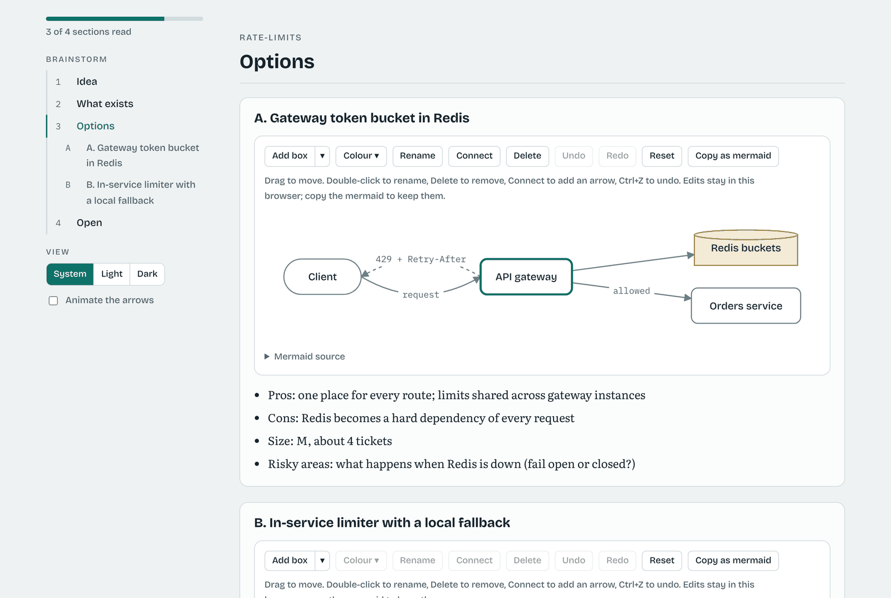

# Brainstorming a feature, and the review page

This page walks through a brainstorm from your side of the chat, then shows Forkboard, the package that draws the review page. The brainstorm is the first two of the guided flow's three stops; [guided-flow.md](guided-flow.md) walks through the whole run, up to the plan's yes and the build. The rules the session follows are in [guides/brainstorm.md](../guides/brainstorm.md); [Brainstorm before planning](#brainstorm-before-planning) below has every detail.

## When to brainstorm

Brainstorm when you know what you want but not how to build it: there are two real ways to do it, or you can't yet say what "done" looks like. Skip it for a small, clear change. The session also offers it on its own when an idea looks fuzzy, and it always brainstorms in `careful`.

## A brainstorm, step by step

In a Claude Code session in your repo (Codex: `$feature-flow` instead of `/feature-flow`):

```
/feature-flow rate-limits brainstorm
```

1. **The start card.** When you name no type, the session asks whether you know the domain, the codebase, both, or are just exploring, and shows the setup it picked (the type, the scout levels and the helpers) in one line. "ok" takes it. Name a type yourself (`brainstorm learn`, `map`, `quick`, `explore`) to skip the card.
2. **Questions.** The session asks up to three, one at a time, and only what the code can't tell it: who it is for, what success looks like, what is off limits.
3. **A look around.** A scout reads how your code does the nearest thing today and which files would change. A web scout looks up prior art when the idea leans on an outside library or a known hard problem.
4. **Options.** Two or three ways to build it that really differ. Each one has a mermaid diagram, two or three pros and cons, a rough size and its risky areas. Helpers can weigh in: the architect, designer or product owner, a skeptic who attacks each option, and lenses (`positive`, `researcher`, `open-minded`, `artistic`, `ux`, `security`), limited to the ones the setup picked. Each idea a helper gave ends with its name in brackets (`[skeptic]`).
5. **The review page.** The session shows the options on the flow's one page (its Options step) and recommends one. It writes the page beside the brainstorm (`.feature-flow/state/brainstorm-<feature>.html`) and opens it, or publishes it as an artifact when it can.
6. **Your pick.** Answer in the chat: pick one, mix two, change one, or drop the brainstorm. The same yes approves the brief that follows, so you approve once.

The brainstorm is saved as `.feature-flow/state/brainstorm-<feature>.md` and committed with the plan as `plans/<feature>/brainstorm.md`. The planner builds the option you chose, and the plan reviewer fails a plan that builds a rejected one.

## Using the page

- **Tabs.** The page has five tabs: Style, Team, Options, Plan and Build. A finished step shows a one-line summary and a Change button, the current one is open with an Approve button, and a later one is greyed out. On the live page, Style's buttons pick the type and the scout levels, Team's boxes the helpers, Options' buttons the option, and each option says what it means. Your picks wait until you press Approve, which saves them and wakes the session.

- **Read.** The sidebar jumps between sections and options. Switch between system, light and dark at its foot.
- **Edit a diagram.** Drag boxes. **Add box** (its arrow picks one of seven kinds and a colour), double-click a box to rename it, **Connect** two boxes, **Delete**, **Undo** and **Redo** (Ctrl+Z and Ctrl+Shift+Z), **Reset**. Edits stay in your browser.
- **Keep an edit.** **Copy as mermaid** copies the edited diagram. Paste it into the chat to change an option.
- **Arrange.** **Arrange** lays a diagram out again: left to right, top to bottom, radial (the most joined box in the middle) or a grid. Undo puts the boxes back.
- **Look.** The session picks a style that fits the subject: `route` (the default), `blueprint` (architecture), `sketch` (early ideas), `paper` (to share or print), `terminal` (infra and dev tools) or `bright` (UI and consumer features). Ask for another, or put `Style: <name>` in the brainstorm. Boxes are coloured by role: people orange, screens purple, services blue, data green, outside systems grey, and red for what an option puts at risk.

## The live page (Claude only)

When the session can publish artifacts, the page is live: a link you can share from its Share menu. The people you share it with need a claude.ai sign-in and edit access, not Claude Code.

- **Save as my version** keeps your version of a diagram on the page, for everyone. Pick anyone's version from the list.
- **Compare with original** marks added, removed and renamed boxes and arrows.
- **Ask Claude to change it** redraws one diagram with your own Claude.
- **Talk to Claude** sends the session a question. Each save wakes the session: it answers on the page, can put someone's version into the brainstorm, and publishes the next round to the same link.

To draw first, start with `/feature-flow rate-limits brainstorm sketch`. The page opens with a small sketch of the idea; you change it, save it and send it, and the options build on your drawing.

## Forkboard on its own

The page is drawn by **Forkboard** ([packages/forkboard/](../packages/forkboard/)). feature-flow carries its own copy, so a brainstorm needs nothing extra. To make the page by hand:

```bash
feature-flow brainstorm-page rate-limits                    # writes .feature-flow/state/brainstorm-rate-limits.html
feature-flow brainstorm-page rate-limits --style blueprint
python3 scripts/flow-status.py rate-limits --page          # the same, from a repo install (--brainstorm-page still works)
```

Forkboard also works without feature-flow, from any JSON review document:

```bash
forkboard render review.json --out page.html
forkboard live review.json live/          # index.html and state.json, to publish as an artifact
forkboard asks live/                      # open questions, each with the asker's version of the diagram
forkboard answer live/ 1 "Yes, for exports over 10k rows."
forkboard version live/ 2 u_dana          # someone's version of figure 2, as mermaid
```

The document format and the rest are in [Forkboard's README](../packages/forkboard/README.md).

## Brainstorm before planning

When an idea is still fuzzy, the session can brainstorm it with you before it writes the brief: `/feature-flow <feature> brainstorm`, always in `careful`, and offered on its own when there is no bar yet or there are two real ways to build it. It asks you up to three questions, one at a time, sends a scout to see how the code does the nearest thing today, then lays out two or three options, each with a mermaid diagram, its pros and cons, its size and its risky areas, and recommends one. Your pick and the brief share one yes.

**Brainstorm types.** A word after `brainstorm` says who the brainstorm is for, and the session suggests one when you name none (one question; "ok" takes its pick, and `auto` or `agent` take it without asking):

| Type | For when you | Code scouts | Web scouts | What changes |
|---|---|---|---|---|
| `standard` | know the domain and the codebase | normal | normal | nothing |
| `learn` | are new to the domain | light | deep | each idea is explained as it comes, and the brainstorm keeps a Glossary with a source for every term |
| `map` | know the domain, not this code | deep | light | up to three scouts map the repository first, each asking something different, into a Repo map |
| `quick` | know both and want it short | light | light | one or two options, one consultant, no skeptic and no lens |
| `explore` | are not sure it is worth building | light | normal | it ends in a Go or No-go Verdict; only a Go goes on to the brief |

`code=<level>` and `web=<level>` after the type set the scouts yourself: `off`, `light` (one scout, no codeintel), `normal`, or `deep` (as many as `careful` allows; before a build, the scouts ask as for a ticket one level higher). The type and the levels are header lines of the brainstorm (`Type: map`, `Scouts: web=off`), so the plan's and the build's scouts follow them after the plan is accepted. `FLOW_SCOUTS=off` still turns every scout off.

Read only helpers work for the session during a brainstorm: a code scout, a web scout, the architect, designer and product owner, `flow-skeptic`, who attacks each finished option so the session that wrote the options is not the one that judges them, and `flow-lens`, who looks at the options through one lens the session picks for the idea: `positive`, `researcher`, `open-minded`, `artistic`, `ux` or `security` ([guides/lenses/](../guides/lenses/)). Each gets its prompt from `brainstorm-prompt <helper> <question file>`, which counts them: `normal` allows 2 scouts, 1 web, 2 consultants, 1 skeptic and 2 lenses per brainstorm, `careful` 3, 2, 3, 1 and 3; the type and the scout levels change these as the table says. A `Helpers:` line in the brainstorm (`Helpers: po skeptic lens=ux`, or `none`) limits the helpers to the ones it names; a helper it leaves out is refused, and so is a line that picks more than the limits allow. Helpers never write the brainstorm and never ask you anything; the session does both. Where each pick fits in the run is in [The guided flow](guided-flow.md).

Before you pick, the session shows the brainstorm as a review page: `feature-flow brainstorm-page <feature>` (or `flow-status.py <feature> --brainstorm-page`) writes it beside the brainstorm as one HTML file. It has a sidebar that routes between the sections and shows how far you read, a system, light or dark switch, flowchart diagrams you can edit (arrange them left to right, top to bottom, radial or as a grid, drag, add boxes of seven kinds, colour them from 12 colours, rename and delete them, connect them with arrows, undo and redo, with the keyboard too), reset, and copy back as mermaid (the edited diagram once you change it; edits are kept only in that browser), and an arrow animation that stays off until you turn it on. Its look is a style: `route` (the default), `blueprint`, `sketch`, `paper`, `terminal` or `bright`, picked with `--style`, the brainstorm's `Style:` line or `FLOW_STYLE`; the session picks the one that fits the subject unless you name one, and colours boxes by role. A style is one CSS file of colour, font and box tokens in Forkboard's [themes/](../packages/forkboard/forkboard/themes/), so adding one is adding a file. `--fragment` leaves out the html and body tags, for publishing the page as an artifact.



What the page is good at:

- **You review the design, not a wall of text.** Each option is a diagram you can see at once, with its pros, cons, size and risky areas right under it, and the sidebar jumps between options.
- **You answer by editing the diagram itself.** Drag, add, rename, connect or delete boxes, then Copy as mermaid and paste it into the chat. Your change reaches the session as a diagram, not a paraphrase.
- **More than one person can review it.** On the live page each reviewer keeps their own version of a diagram, compare with original marks what they added, removed or renamed, and their questions wake the session, which answers on the page.
- **One file, nothing to install or host.** The plain page is a single HTML file that needs no server and no account: open it from disk, or publish it as an artifact. It sends nothing anywhere (it only loads its fonts, and mermaid for a diagram that is not a flowchart), and the brainstorm's text is escaped, so a label cannot run a script.
- **Its own package, tested in a browser.** The page's editor, its phone layout and the live page's saves are driven in Chromium in CI, apart from the harness.

The page itself is **Forkboard** ([packages/forkboard/](../packages/forkboard/)), a separate package in this repository with its own version and tests. feature-flow turns the brainstorm into a review document and Forkboard makes the page from it; Forkboard never reads or writes the brainstorm file. Every install of feature-flow carries its copy of Forkboard (as `feature_flow/_forkboard/`), so nothing extra needs installing.

**The live page (Claude only).** When the session can publish artifacts, it publishes the page live instead (`--live <folder>` writes `index.html` and a `state.json` beside it). Everyone you share it with (a claude.ai sign-in and edit access, no Claude Code needed) can save their own version of each diagram, pick between the original and anyone's version, turn on **Compare with original** to see added, removed and renamed boxes and arrows marked, ask Claude in the page to change a diagram (it uses that person's own Claude), and send the session questions from **Talk to Claude**. A save wakes the session: it reads the page's `state.json`, lists the open asks (`--asks`), answers each one (`--answer`), puts a version into the brainstorm when asked (`--apply <folder> <figure> <version>`), and publishes the next round to the same link. `/feature-flow <feature> brainstorm sketch` starts from your own drawing: the page opens with a small sketch of the idea, you draw yours and send it, and the options build on it. Without an Artifact tool (or on Codex) you get the plain page.

[docs/brainstorm.md](brainstorm.md) walks through a brainstorm step by step, how to use the page, and Forkboard's own commands.

The result is `brainstorm.md` ([template](../guides/templates/brainstorm.md)), committed with the plan. The planner follows its chosen option and copies its diagram into `spec.md`, the plan reviewer fails a plan that builds a rejected option or leaves a risky area below level 3, and a re-plan keeps the choice. It is skipped in `fast`, for an import, and with `auto`; with `agent`, the driving agent picks, the file says `Picked by: agent`, and the eval records it.

## What has not been tried yet

The guided flow's stops and the Setup and Plan steps' choices have not had a field run yet. The live page's loop (a person saves, the session wakes, answers and publishes again) has only run against a stand-in in tests. If you try either, [docs/field-run.md](field-run.md) says what to send back.
