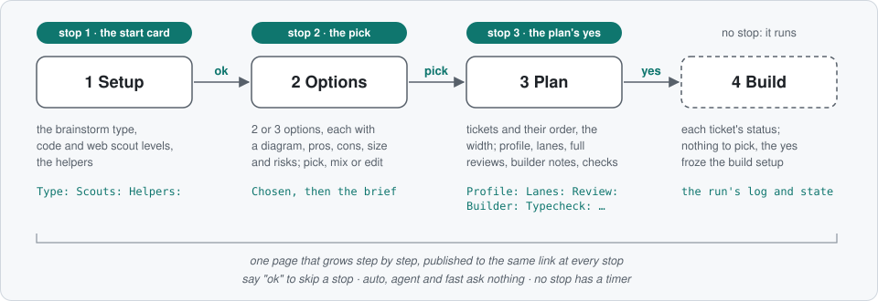
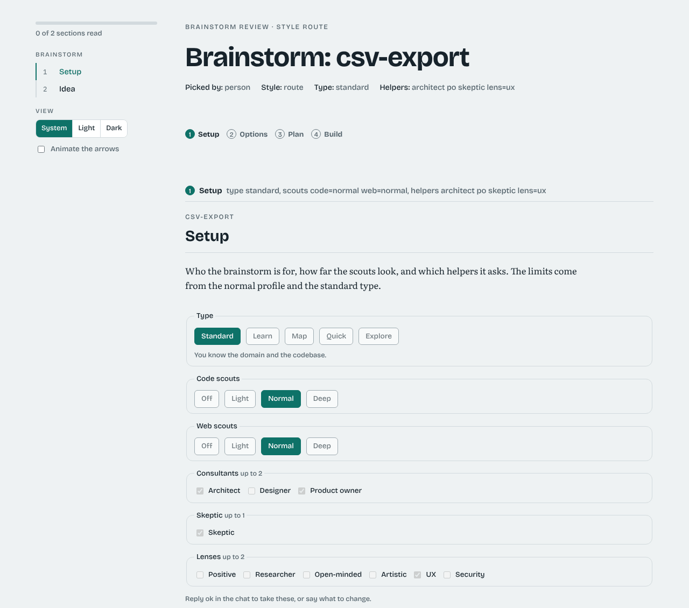
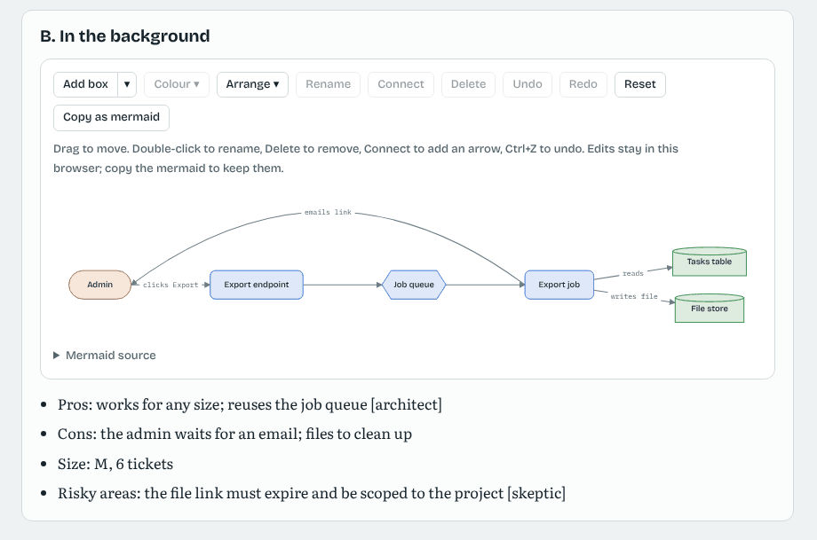
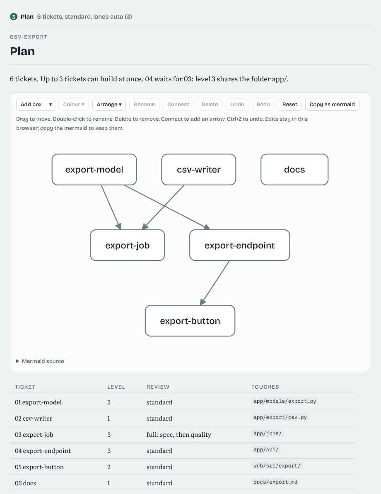
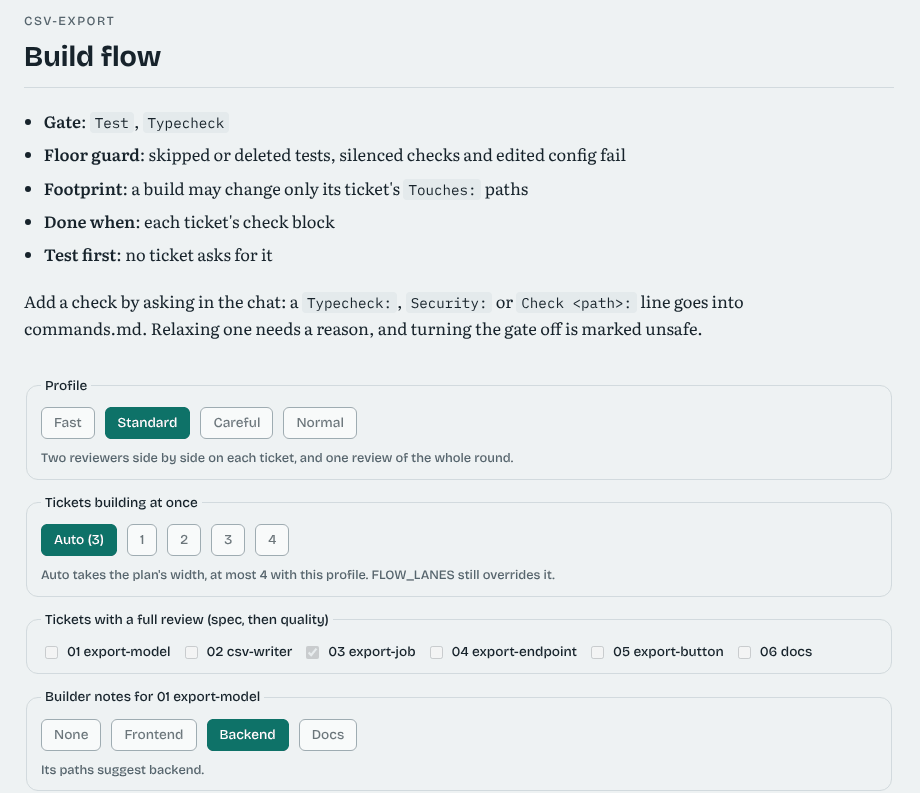
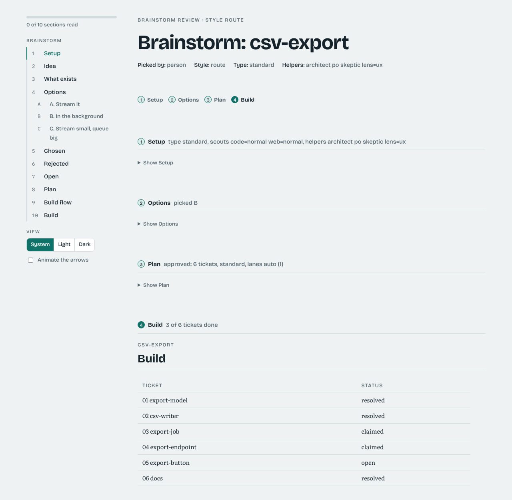

# A guided run, from your side of the chat

This page walks through the guided flow: the path from an idea to a running build with three stops. The rules the session follows are in [guides/brainstorm.md](../guides/brainstorm.md) and [guides/brief.md](../guides/brief.md); the [README](../README.md#what-a-run-looks-like) has the summary and [the guided flow in full](#the-guided-flow-in-full) below has every detail.



The pictures below are the page for a sample `csv-export` feature, taken at each stop.

Every stop is skippable. Say "ok" and the session takes its pick. With `auto`, `agent` or `fast` it asks nothing and takes the defaults. No stop has a timer, so a stop waits for you.

## Stop 1: the start card

```
/feature-flow rate-limits brainstorm
```

When you name no type, the session asks one question:

> Do you know the domain, the codebase, both, or are you just exploring?

Your answer picks the [brainstorm type](brainstorm.md#brainstorm-before-planning):

| You say | Type | What changes |
|---|---|---|
| new to the domain | `learn` | ideas are explained as they come, with a cited Glossary; deep web scouts |
| new to this code | `map` | scouts map the repository first; deep code scouts |
| I know both | `standard` (or `quick` to keep it short) | the usual brainstorm (`quick`: one or two options, few helpers) |
| just exploring | `explore` | it ends in a Go or No-go, and only a Go goes on to a brief |

Then it shows the setup in one line, for example:

> `learn`: web scouts deep, code light, with the product owner, the skeptic and the `ux` lens. ok, or change it?

"ok" takes it. To change it, say so ("no skeptic", "code=deep"), or, on the live page, pick in the Style tab (the type and the scout levels) and press Approve, then in the Team tab (the helpers) and press Approve. You start in a style, and the team comes after it, from that style's defaults. The setup is written into the brainstorm's header (`Type:`, `Scouts:`, `Helpers:`), and later the plan's scouts and the build's scouts follow the same levels.



To skip the card, name the type yourself: `/feature-flow rate-limits brainstorm map code=deep`.

## Stop 2: the brainstorm's pick

The session asks its helpers, then shows two or three options on the page, each with a diagram you can edit, its pros, cons, size and risky areas, and the option it recommends. Each idea that came from a helper says so in brackets (`[architect]`, `[ux]`).



Pick one, mix two, change one (edit its diagram and copy it back as mermaid), or drop the brainstorm. The same yes approves the brief that follows. [brainstorm.md](brainstorm.md) shows how to use the page.

## Stop 3: the plan's yes

The planner drafts the tickets, and the session shows them on the page's Plan step, with one line that sums up the build, for example:

> standard, up to 3 at once, gate + typecheck. Write this plan, commit it and start building? yes, edit, or cancel.

What the Plan step shows:

- **The tickets and their order**, as a diagram and a table with each ticket's level, its review and the paths it changes.
- **The width**: how many tickets can build at once, and why each waiting ticket waits (`04 waits for 03: level 3 shares the folder app/`). The same comes from `python3 scripts/flow-status.py <feature> --width`.
- **The checks** every ticket must pass: the gate's commands, the floor guard, the footprint, Done when and test first.



What you can change before you say yes:

| Choice | Options | Written to the draft |
|---|---|---|
| Profile | `fast`, `standard`, `careful`, `normal` | `Profile:` in `commands.md` |
| Tickets building at once | Auto (the plan's width, at most 4, at most 2 with `careful`, 1 with `fast`), or 1 to 4 | `Lanes:` in `commands.md` |
| When the full gate and review run | `each`, `batch 2`, `batch 3`, `batch 5` or `end`; the profile's default is shown (`fast` end, `standard` batch 3, `careful` each) | `Gate:` in `commands.md`, left out when it is the profile's default |
| Full review | any tickets, which then get a spec review and a quality review | `Review: full` in the ticket |
| Builder notes | none, `frontend`, `backend` or `docs` per ticket; the page shows what its paths suggest | `Builder:` in the ticket |
| Add a check | ask in the chat: a type check, a security scan, or a command for one part of the repo | `Typecheck:`, `Security:` or `Check <path>:` in `commands.md` |
| Relax a check | ask in the chat, and give the reason | `Floor: allow <category>, reason: <why>` in `commands.md`, and the reason in `decisions.md` |



**When the gate runs.** With `each`, every ticket gets the full gate, its Done when checks and its own review. With `batch N` or `end`, each ticket gets only the cheap checks (Quick, the floor guard, the footprint, test first), and every N tickets (or once at the end) the conductor runs the full gate and the Done when checks at HEAD, then one reviewer reads those tickets together. A failure is put on the one ticket that caused it, which alone is built again. The Build flow section says which one the plan uses (`When: Gate: batch 3, ...`). See [When the gate runs](speed.md#when-the-gate-runs-checkpoints).

Turning the gate off is possible only as `Gate: off unsafe`. The session says plainly that the run is then unsafe, and the report and eval say so in their first line.

One yes approves the plan and its build setup together. Both are frozen with the plan, so nothing on the page can change them once the build starts. To change them later, ask for a re-plan.

## The build

The page's Build step shows each ticket's status as the run goes. Nothing on it is a choice. A ticket is built, gated and reviewed as [How a ticket flows](how-it-works.md#how-a-ticket-flows) says, in as many [lanes](speed.md#tickets-side-by-side-lanes) as the plan's yes allowed. `FLOW_LANES` on `start` still overrides the plan's `Lanes:` line.



After the plan is accepted, the session offers to clean up the brainstorm's spent files: `python3 scripts/flow-status.py <feature> --clean` lists them, and `--clean --yes` deletes them.

## How it is measured

`feature-flow eval <feature>` prints two lines for the guided flow:

```
guided stops: 3 (setup, options, plan; the aim is 3 or fewer)
helpers' ideas (asked, ideas, in the pick): architect 2/3/1, skeptic 1/2/0, ux 1/1/1
```

A run that stopped more than three times shows where the extra stops came from. A helper that is asked often but whose ideas never reach the pick is one to drop from the setup. [field-run.md](field-run.md) says what to send back.

## Without the live page

On Codex, or when the session cannot publish artifacts, the page is a plain HTML file beside the brainstorm (`.feature-flow/state/brainstorm-<feature>.html`), and you answer each stop in the chat. The stops, the choices and what gets written are the same.

## The guided flow in full

The guided flow is the path from an idea to a running build with as few questions as possible. It stops **three times**, and you can skip each stop by saying "ok" (or let `auto`, `agent` or `fast` take the defaults and ask nothing). There is no timer: a stop waits for you.


| Step | What it shows | What you can pick | Written to |
|---|---|---|---|
| **Style** and **Team** (stop 1, the start card) | "Do you know the domain, the codebase, both, or are you just exploring?", then one line with the setup | the [brainstorm type](brainstorm.md#brainstorm-before-planning), the code and web scout levels (off, light, normal, deep), the helpers (consultants, the skeptic, lenses), capped by the limits | the brainstorm's `Type:`, `Scouts:` and `Helpers:` lines |
| **Options** (stop 2) | two or three options, each with an editable diagram, pros, cons, size and risky areas, and the session's pick | an option, a mix, an edited diagram, or drop the brainstorm | the brainstorm's Chosen section, then the brief |
| **Plan** (stop 3, the plan-yes card) | the drafted tickets, their order, each ticket's level and review, how many can build at once and why the others wait, and the checks | the profile, the lanes, which tickets get a full review, each ticket's builder notes; adding or relaxing checks in the chat | the draft's `commands.md` (`Profile:`, `Lanes:`, check lines) and tickets (`Review: full`, `Builder:`) |
| **Build** | each ticket's status as the run goes | nothing: the plan's yes froze the build setup | the run's log and state |

**One page.** All the steps are one page with a tab each, Style, Team, Options, Plan and Build: `flow-status.py <feature> --page` (the same as `--brainstorm-page`, or `feature-flow brainstorm-page <feature>`). A finished step shows a one-line summary and a Change button, the current step is open with an Approve button, and a later one is greyed out. Each choice says what each of its options means. When the session can publish artifacts, it publishes the [live page](brainstorm.md#brainstorm-before-planning) to the same link at each stop, so you keep one page. A pick stays on the page until you press the tab's Approve, which saves the tab's picks into the page at once and wakes the session; the session runs `--page --picks <live folder>` to write them into the files in the last column, and publishes the page again with the next tab open. Approving the Plan tab is the plan's yes. Each proposed option, and each ticket in the Plan tab, has an Ask Claude button for a question about that one; the answer comes back in the page's Talk to Claude panel. The page writes nothing else. Anywhere else (Codex, or no Artifact tool) you answer the same one question in the chat.

**The plan-yes card sets up the build.** One yes approves the plan and its build flow together, and both are frozen with the plan, so a picked profile or lane count cannot change mid-run. The card says it in one line, for example "standard, up to 3 at once, gate + typecheck":

- **Width.** `flow-status.py <feature> --width` prints how many tickets can build at once and, for each waiting ticket, what it waits for (a blocker, an overlapping `Touches:`, a `Shared:` path, or a level 3 ticket in the same folder).
- **Lanes.** A new plan's `Lanes: auto` builds up to the plan's width side by side: at most 4, at most 2 with `careful`, and 1 with `fast` (which batches instead), under `FLOW_RELAY`, or when the session is not at the top of the repo. `Lanes: 1` to `4` sets it yourself, `FLOW_LANES` still overrides both, and a plan with no line keeps one lane. The log records `LANES-AUTO-<n>`. See [Lanes](speed.md#tickets-side-by-side-lanes).
- **Builder notes.** A ticket's optional `Builder: frontend`, `backend` or `docs` adds that kind of code's notes ([guides/builders/](../guides/builders/)) to its build prompt. It is the same builder agent with a few more things to watch for. The page shows what the ticket's paths suggest and lets you switch it.
- **Adding checks.** Ask in the chat and the session adds the line to the draft's `commands.md`: `Typecheck:` and `Security:` run after Lint, and `Check <path>: <command>` runs only for a ticket that changes that path. The checks have their own 3 send-backs, so a flaky test does not use up a ticket's review rounds.
- **Relaxing checks.** `Floor: allow <category>, reason: <why>` relaxes the floor guard for the whole plan, and the reason goes into `decisions.md`; a line without a reason stops the run (`FLOOR-RELAXED-<CAT>` in the log). The gate goes off from the plan only as `Gate: off unsafe`, and the report and eval then say "gate off (unsafe)" in their first line.

**Measuring it.** The session logs each stop (`asked setup`, `asked options`, `asked plan`), and every idea a brainstorm takes from a helper ends with that helper's name in brackets (`[architect]`, `[ux]`). `feature-flow eval` prints how many times the run stopped for you (the aim is 3 or fewer) and, per helper, how often it was asked, how many of its ideas went in and how many reached the option you picked, so a helper that never helps can be dropped.

**Cleaning up.** After the plan is accepted, `flow-status.py <feature> --clean` lists the brainstorm's spent files in `.feature-flow/state/` (the helpers' question and reply files, its counts, and the plain page once a live page exists), and `--clean --yes` deletes them. The plan keeps its own copy of the brainstorm.


[docs/guided-flow.md](guided-flow.md) walks through a guided run from your side of the chat, with a picture of the page at each stop.
