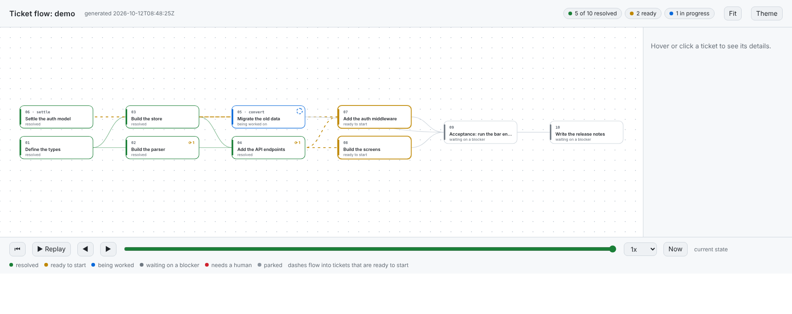

# How it works

[← README](../README.md) · [Docs index](README.md)

What happens to a feature from your first yes to the last review: planning, each ticket's checks, the review levels, the agent roles and the graph page.

## What is in the box

One skill, 12 agent roles, a Python conductor, 6 Python scripts (`flow`, `flow-trust`, `flow-status`, `flow-view`, `gate`, `floor-guard`), an installer for both agents, a Claude Code plugin, a PyPI package, a demo and a test suite. All of it is Python (standard library only), so it runs on Linux, macOS and Windows. MIT licensed.

## Planning

The same command plans when `plans/csv-export/` does not exist yet and builds when it does. After your second yes it commits the new plan folder, and only that folder, then goes straight on to building it; say so if you want it to stop after planning.

**Planning asks you twice.** First the session shows a short feature brief, written from your conversation (what, why, scope, the bar, and anything it had to assume), and waits for yes, edit or cancel. Then a fresh `feature-planner` subagent, given only that brief, reads the code, looks up outside docs where the code cannot answer, and writes a draft plan into the git-ignored `.feature-flow/state/draft/`. The planner folds changes too small to stand alone into the ticket they belong to, and gives every ticket a level (1 light, 2 standard, 3 boundary) that decides how much review it gets. A fresh `plan-reviewer` checks the draft against the brief. The session shows you the goal, the commands, the ticket graph, what was dropped and the review result, and waits for a second yes. Only then does `flow.py plan-accept` copy the draft into `plans/<feature>/`, and the session commits it and starts the build.

## How a ticket flows

```
 tester subagent (once, before the first ticket, when commands.md
   has Acceptance:): writes acceptance tests from spec.md only
        │
        ▼
 smoke command (script): is the base healthy?   no ─► stop, spend nothing
        │ yes
        ▼
 pick ticket ─► builder subagent: claim, build, prove it (run fresh, read the output), commit
                                              │
                                              ▼
 gate (script):  Build, Test, Lint from commands.md           fail ─┐
                                              │ pass                │
                                              ▼                     │
 floor guard (script, no AI):                                       │
   tests skipped or deleted? checks silenced? empty catches?        │
   thresholds lowered? lint/test/CI config edited?             fail ─┤
   plan touched beyond own Status + Answer + appended lines?        │
                                              │ clean               │
                                              ▼                     │
 footprint (script): only the paths on the ticket's Touches:  fail ─┤
                                              │ pass                │
                                              ▼                     │
 Done when checks (script): runs every ```check block          fail ─┤
 test-first check (script): Test first: yes needs a test-only        │
   commit that failed Test before the code                     fail ─┤
                                              │ pass                │
                                              ▼                     │
 review: one fresh reviewer subagent, sees only the ticket         │
 + diff: the spec checklist, then the code's quality; at level 3     │
 it also probes every input as a hostile caller               FAIL ─┤
                                              │ PASS                ▼
                                              ▼        findings written into the ticket,
                                     next ticket       reopened, built again (rounds by level);
                                                       the builder's prompt then carries
                                                       a root-cause debugging guide

 every ticket resolved: the acceptance tests run (script)     fail ─► fix ticket, built and
                                                                      reviewed like any other
```

`scripts/flow.py` is the conductor. The session asks it `next`, and it answers with one line: `TEST`, `BUILD`, `REVIEW`, `ASK`, `DONE`, `STOP` or `HANDOFF`. It prints the full prompt for each subagent from runtime-neutral guides, so the session never writes one itself.

**What the script checks and what it trusts.** The conductor verifies the build from the repo: the ticket file must say `resolved`, the tree must be clean and committed, and it runs the gate and the floor guard itself. It also runs the `check` block under each ticket's Done when and compares the exit code and printed text (a check with a `needs <what>` line, such as `needs network`, that fails is deferred instead: the reviewer is told it is not met, and it goes to `followups.md`), and for a `Test first: yes` ticket it proves the red test commit itself: it checks out the test-only commit, runs Test, and requires it to fail before the code. A failure of either goes back to the builder before any reviewer is started. It also checks that the reviewer changed no tracked file and made no commit (an edit is put back and the review given to a fresh reviewer, see Read only roles below). The review verdicts are different: each reviewer's reply is relayed by the session, which saves it to a file and hands it to `flow.py verdict`. The script reads `REVIEW: PASS` or `REVIEW: FAIL` from that reply; it cannot prove the session passed it on unedited. A ticket with a `Level:` line moves on after one PASS verdict. A ticket with no level (a plan from before 0.9.0) needs two, a spec review and then a quality review, unless the conductor judged it small. The size is measured from the repo (`git diff` against the commit the ticket started from), never taken from the builder.

**The gate: full or quick.** The gate runs Build, Test and Lint after every ticket. With an optional `Quick:` line in `commands.md` (a faster subset of `Test`), it runs Build, Quick and Lint after the tickets in the middle of a plan, and the full Build, Test and Lint after the last ticket, before a handoff, and under `FLOW_GATE_FULL=1`. A plan without `Quick:` runs the full gate every time. The test-first proof still runs the full `Test` command. A `Gate: batch N` or `Gate: end` line moves the full gate to checkpoints instead (see [When the gate runs](speed.md#when-the-gate-runs-checkpoints)).

**Ticket levels.** The planner writes `Level: 1`, `2` or `3` in each ticket, the plan reviewer checks it against written rules, and you approve it with the plan.

| | Level 1 (light) | Level 2 (standard) | Level 3 (boundary) |
|---|---|---|---|
| For | tests, docs, prompt text, spikes, the acceptance ticket | ordinary feature code | auth, tokens, permissions, money and run limits, data loss, the flow's own code, anything a hostile caller reaches |
| Reviews | one combined review | one combined review, spec checklist first | one combined review that also probes every input as a hostile caller |
| Rework rounds | 1, then the run stops for you | 2; from round 3 only a `blocker` sends it back, majors go to `plans/<feature>/followups.md` and the ticket passes | `FLOW_MAX_REVIEW_ROUNDS` (3), then the run stops for you |

The gate does not depend on the level: it still runs Quick mid-plan and the full Test on the last ticket and before a handoff. Nobody but you can lower a level. The conductor reads `Level:` from the ticket as it was at the base commit, so a builder's edit does nothing (and the floor guard fails it). It raises the level from what it measures, never lowers it: `Review: full`, `Type: convert` and `Floor: allow flow-edit` make a ticket level 3, so does a diff that touches a path on the optional `Sensitive:` line of `commands.md` (frozen by the floor guard), and a level 1 diff over the small limits becomes level 2. A reviewer can raise it with a line `LEVEL: 3` above the verdict; a raise to 3 during a combined review adds a quality review. The log records `LEVEL-1`, `LEVEL-2` or `LEVEL-3` for each review round, and `feature-flow report` shows it.

**One review at level 3 too (0.23.0).** Before 0.23.0 a level 3 ticket got a spec review and then a separate quality review. In the first field run (two features, 19 separate spec reviews), every real catch came from the quality review: the spec review re-ran the Done when checks the conductor had already run and passed, and found nothing they had missed. So a level 3 ticket now gets one review, which does the spec checklist (marking bullets the conductor's check block covered as `MET (conductor)` instead of running them again) and then the quality review with the hostile caller probe. That saves a fresh reviewer per level 3 ticket. A reviewer that raises a ticket to level 3 in a combined review still adds a quality review after it, since it did not probe the change as level 3.

**One review for a small ticket (no level).** A ticket with no `Level:` line, from a plan written before 0.9.0, keeps the 0.8.0 rules. A ticket whose built diff is 3 files and 60 changed lines at most (the plan folder left out), and whose `check` block ran and passed, gets one combined review instead of the spec and quality reviews. The conductor measures the diff itself. `Review: full` in the ticket (as it was at the start), `Type: convert`, no `check` block, or `FLOW_GATE=off` keep both reviews. Every other conductor check still runs on every ticket.

## The skill and the roles

| Skill | What it does |
|---|---|
| `feature-flow` | **Plan:** turns the conversation (or your answers) into a feature brief and waits for a yes, has a planner and a plan reviewer subagent draft and check `plans/<feature>/` (a spec, a map, commands, learnings and tickets), shows you the graph, and writes it after a second yes. **Build:** runs the tickets one by one, a builder and a reviewer subagent each, with `flow.py` deciding every step. **Show:** the animated ticket graph and a summary of what is ready and what blocks the finish. |
| `architect-review` | Architecture review of a file, diff or feature, with severity rated findings. Reads `CLAUDE.md` or `AGENTS.md` for the project's own rules. |
| `automation-design` | Blueprint for an automation pipeline. Hands off to `feature-flow` for the plan. |

| Role | Tools | Job |
|---|---|---|
| `ticket-builder` | Read, Glob, Grep, Edit, Write, Bash | Builds one ticket (or, in fast mode, a batch of small ones) by the build guide in its prompt. |
| `ticket-reviewer` | Read, Glob, Grep, Bash (no Edit, no Write) | Reviews one ticket, or the whole feature on the fast path, by the review guide in its prompt and ends with `REVIEW: PASS`, `REVIEW: FAIL` or `REVIEW: ASK <role>`. |
| `feature-planner` | Read, Glob, Grep, Bash, Write, WebSearch, WebFetch | Plans one feature from the approved brief by the plan guide, writes only the draft, cites outside sources, and ends with `PLAN: READY` or `PLAN: QUESTIONS`. Also folds open tickets on a re-plan. |
| `plan-reviewer` | Read, Glob, Grep, Bash (no Edit, no Write) | Checks the draft against the brief by the plan review guide and ends with `PLAN-REVIEW: PASS` or `PLAN-REVIEW: FAIL`. |
| `flow-tester` | Read, Glob, Grep, Edit, Write, Bash | Writes the feature's acceptance tests from `spec.md` alone, before the build, by the test guide. Never reads the tickets. |
| `flow-scout` | Read, Glob, Grep, Bash (no Edit, no Write), Haiku | Reads the code ahead of a planner, builder, reviewer or consultant and reports what it found. Decides nothing. |
| `flow-web` | WebSearch, WebFetch, Haiku | Looks up outside facts for the planner or a brainstorm, with sources. |
| `flow-architect`, `flow-designer`, `flow-po` | Read, Glob, Grep, Bash (no Edit, no Write) | Answer one technical, UI or product question a builder, reviewer or planner asked, or (`flow-po`) rule on a disputed acceptance test. |
| `flow-skeptic` | Read, Glob, Grep, Bash (no Edit, no Write) | Attacks each option a brainstorm drafted: one objection and one hidden cost each. |
| `flow-lens` | Read, Glob, Grep, Bash (no Edit, no Write) | Looks at a brainstorm's options through one lens (`positive`, `researcher`, `open-minded`, `artistic`, `ux`, `security`) and reports what it sees. |

**Read only roles.** The reviewers, the consultants (`flow-architect`, `flow-designer`, `flow-po`), the brainstorm helpers (`flow-skeptic`, `flow-lens`) and `flow-scout` have no Edit or Write tool, and in Claude Code a `PreToolUse` hook in their role file blocks shell commands that change files or the repository: git commands that write (`commit`, `add`, `stash`, `checkout`, `reset` and the like), `sed -i`, `rm`, `mv`, `cp`, `touch`, `tee` and output redirected into a file other than `/dev/null` or `/tmp/`. The hook reads the command's text, so a program that writes files itself (a test runner updating snapshots, a script) still gets through, and Claude Code ignores hooks in a plugin's agents. A Codex subagent cannot be limited at all: Codex gives every child its parent's sandbox. So the conductor is the backstop everywhere: when a reviewer or consultant leaves a tracked file changed, it saves the change as `.feature-flow/state/edit-<feature>-<NN>.patch`, puts the files back, throws that answer away and hands the same review to a fresh reviewer, with a note saying why (`EDIT-UNDONE` in the log). A second edit in a row stops the run, and so does a commit, which it cannot undo safely. A planner's draft reaches `plans/` only through `plan-accept`. On Codex the planner can research the web only if web search is on; otherwise it plans from the code and says so. The Codex planning path has not been run by hand.

The guides in `guides/` (installed to `.feature-flow/guides/`) hold the protocol: how to build, review, write the brief, plan, review a plan and show. The skill holds only what differs per agent.

## See the graph



*The page `flow-view` writes, shown for the demo plan from `examples/demo.sh`: resolved tickets in green, ready ones in amber, the one being worked in blue, the rest waiting. Press Replay to watch the run back from git history.*

```bash
python3 scripts/flow-view.py csv-export            write the page and open it (or: feature-flow view csv-export)
python3 scripts/flow-view.py csv-export --watch    keep it updating while tickets are built
bash examples/demo.sh --open                    try it on a made up project, no setup needed
```

One self contained HTML file: no server, no libraries, no network, light and dark. It is written to `.git/flow-<feature>.html`, so it never dirties the tree (`--out FILE` writes it elsewhere).

```
  01 types ──► 02 service ──► 04 acceptance        ● resolved  ◉ ready (pulses)
        └────► 03 wire ──────────┘                 ◌ being worked (spins)  ○ waiting
  ▶ replay ──●──────●─────○──────────   drag to scrub through the run
```

- **Layered left to right**, so the order of work is visible. Dashes flow along the edges into tickets that are ready to start.
- **Replay** plays the run back from git history: tickets turn green in the order they resolved, and a ticket sent back by the gate, the guard or the reviewer flashes red.
- **Hover or click** a ticket for its blockers, Done when, Answer, and the rounds it was sent back.
- **Keys:** space plays or pauses, the arrows step, End shows now, `t` switches theme. Reduced motion is respected.
- **Safe by construction:** ticket text comes from files an agent wrote, so it is escaped when embedded and only ever inserted as text.
- `flow-status.py <feature> --json` prints the same data for other tools. Mermaid (`--mermaid`) remains the choice for pull requests, because GitHub renders it.
