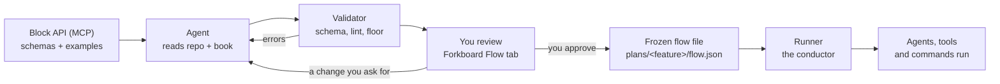

# Research: block-based agent flows

[← README](../../README.md) · [Docs index](../README.md)

Research from 2026-11-24, written against feature-flow 0.46.0 (3674409). This is a design proposal, not a feature: nothing here is built yet.

The question: each repo needs its own flow. Could an agent build that flow from typed blocks (in the spirit of Blockly, without its UI), served by an API it can query, guided by a "book" that teaches how to compose them, show the flow to you, and have a runner execute the file?

## Recommendation

Yes, build it, but take Blockly's ideas rather than its file format. Define each block as a JSON Schema, write flows as a flat list of steps, and let the existing conductor become the runner.

- **Blocks:** about 12 typed blocks (agent, command, check, gate, for each ticket, parallel, review, ask human, when, use flow, page, tool). Each has a JSON Schema plus a book page.
- **Agent API:** an MCP server (and the same calls on the CLI) with `list_blocks`, `get_block`, `validate_flow`, `explain_flow` and `save_flow`. No web server is needed to start.
- **Book:** one guide that teaches composition rules, with the five modes (fix, small, feature, careful, explore) as worked examples.
- **Safety floor:** the floor guard, read-only roles and the gate stay outside the flow. A flow can add checks but can only turn one off with an `unsafe` mark, as today.
- **Review:** a Flow tab on the Forkboard page shows the graph and what changed from the mode's default. The approved flow is frozen with the plan, like `commands.md`.
- **First step changes nothing:** write today's five modes as flow files and prove they match the current conductor with the golden tests. Size is the project's main risk, so the flow file must replace settings, not add to them.

## The idea, and what stepper already proves

Each repo needs its own flow. Today that comes from a mode plus about nine settings plus `commands.md` lines. The idea is to let an agent build the flow from blocks, show it to you, and have a runner execute the file.

The author's automation-stepper repo (private) already does this for browser tests, and most of its design carries over:

| Stepper piece | What it does | Carries over to feature-flow as |
| --- | --- | --- |
| `workflows/*.json` | A list of steps, each `{action, description, element, extra}` | The flow file |
| `actions/factory.py` | Maps an action name to a strategy class | Block type to handler (today's conductor phases) |
| `runner/when_eval.py` | `when` with `context_equals`, `url_contains`, `element_exists`, `all`, `any`, `not` | The `when` block: a small, fixed set of conditions, no code |
| `retry`, `retry_delay_ms` | Retries a step | Review rounds and rebuilds, bounded by ticket level |
| `run_workflow` | Runs another workflow file as a step | `use_flow`: modes and shared pieces as reusable flows |
| `planner/planner.py` | Claude turns a sentence into steps, using a prompt that lists the actions | The agent plus its book |
| `{{query}}`, `ENV:NAME` | Variables and secrets | Flow inputs and settings |

Two gaps in stepper are worth fixing here. First, `extra` is a free-form dict, and the planner learns the actions from prose in its prompt, so nothing checks a step before it runs. Second, it runs strictly in order, with no parallel steps and no stop for a human.

## Blockly's format, and the alternatives

Blockly's model is a good fit; its file format is not. Its [block definitions](https://developers.google.com/blockly/guides/create-custom-blocks/define/structure-json) give each block a type, typed inputs (`check`), and say whether it chains as a statement (`previousStatement`, `nextStatement`) or plugs in as a value (`output`). That is exactly the typing a flow needs. But most of the definition is layout: `message0` text with `%1` holes, `args0`, `colour`, `tooltip`. A saved workspace nests every next block inside the one before (`next.block.next.block…`) and stores x and y positions. Agents write that badly, and its diffs are hard to read.

So keep the three ideas (typed inputs, statement versus value blocks, a check on what may connect) and express them in JSON Schema, which agents already use for tool calls and which standard libraries validate. If a drag-and-drop editor is ever wanted, Blockly definitions can be generated from the schemas later.

| Option | What to take from it | Why not adopt it whole |
| --- | --- | --- |
| Blockly JSON | Typed inputs, statement versus value blocks, connection checks | Layout fields and deeply nested saves; it is an editor, not a runner |
| GitHub Actions YAML | Flat steps with `id`, `needs:` for order, `if:`, matrix, reusable workflows | Built for CI jobs on machines, with no agent, review or human-stop steps |
| [Serverless Workflow](https://github.com/serverlessworkflow/specification) (CNCF) | A published JSON/YAML workflow language with a schema: call, fork, try, wait for event | Large spec aimed at service calls; adopting it adds far more than feature-flow uses |
| Temporal, Argo | Durable, resumable execution | Separate servers to run; feature-flow is stdlib Python with git as its state |
| n8n | Node graph with a visual editor | Hosted app with its own runtime; not a file in the repo |
| LangGraph | Agent graphs with state and loops | Flows are Python code, not data an agent can safely write and you can review |

Recommendation: a feature-flow schema shaped like GitHub Actions (flat steps, ids, `needs`, `when`), with Blockly-style typed inputs, and stepper's small `when` language. It reads like the CI files you will already have next to it.

## Block set

Twelve blocks cover everything the five modes do today. Each maps to code feature-flow already has, so the first version wraps existing pieces instead of writing new ones.

| Block | Inputs | Today's code it wraps |
| --- | --- | --- |
| `agent` | role, model, guide, read only, tools allowed | The 12 roles in `agents/`, prompts from `conductor/prompts.py` |
| `command` | a `commands.md` name (Build, Test, Lint, Smoke, Quick) or a shell line, timeout, `needs network` | `verify/gate.py` |
| `check` | one of: floor guard, footprint, done when, test first, acceptance | `verify/floorguard.py`, `verify/checks.py`, `verify/proof.py` |
| `gate` | commands and checks to run, `each`, `batch N` or `end` | `conductor/checkpoint.py` |
| `for_each_ticket` | the ticket graph, lanes (1 to 4), batch size, the steps per ticket | `conductor/schedulers/` (serial, lane, batch, end) |
| `parallel` | steps that run side by side | Paired reviewers, lanes |
| `review` | reviewers, rounds by level, what a FAIL sends back to | `conductor/phases/review.py`, `policy/levels.py` |
| `ask_human` | the question, the card or page, what a yes unlocks | Start card, plan yes, `ASK` |
| `when` | level, mode, `touches` a path, a verdict, a ticket field; `all`, `any`, `not` | `policy/levels.py`, `Sensitive:` |
| `use_flow` | another flow file, inputs | New, like stepper's `run_workflow` |
| `page` | Forkboard page and tab | `pages/` |
| `tool` | an MCP server and tool, arguments | New: codeintel today, others later |

A trimmed `feature` mode as a flow file:

```json
{
  "flow": "feature",
  "version": 1,
  "steps": [
    { "id": "plan", "use_flow": "plan-with-brief" },
    { "id": "approve", "ask_human": { "card": "plan-yes" }, "needs": ["plan"] },
    { "id": "build", "needs": ["approve"],
      "for_each_ticket": { "lanes": "auto", "max_lanes": 4, "steps": [
        { "id": "scout", "agent": { "role": "flow-scout", "model": "haiku" } },
        { "id": "code", "agent": { "role": "ticket-builder" } },
        { "id": "checks", "check": ["floor-guard", "footprint", "done-when"] },
        { "id": "review", "review": { "reviewers": 2, "rounds": "by-level", "on_fail": "code" } },
        { "id": "security", "when": { "level": 3 },
          "agent": { "role": "flow-lens", "lens": "security" } }
      ] } },
    { "id": "gate", "gate": { "run": ["Build", "Test", "Lint"], "every": "batch 3" } }
  ]
}
```

The language can grow, but each new construct should be a new block with its own schema, never free code inside a string. Loops stay bounded: `for_each_ticket` runs over a known list, and `review` rounds have a cap.

## Book, API, validation and your review



The agent only writes the file. The validator and you decide whether it runs, and the conductor runs it.

**The block API.** An MCP server that ships with feature-flow, with the same calls on the CLI for scripts and CI. It runs locally, so there is no server to host.

| Call | Returns |
| --- | --- |
| `list_blocks` | Every block type with one line on what it is for |
| `get_block(type)` | Its JSON Schema, its book page and two examples |
| `validate_flow(file)` | Errors with the exact path, such as `steps[2].review.rounds: must be 1 to 5` |
| `explain_flow(file, plan)` | The steps it would run for a given ticket list, in plain lines, without running anything |
| `diff_flow(file, mode)` | What differs from a mode's default flow |
| `save_flow(file)` | Writes the draft, only if it validates |

**The book.** One guide in `guides/`, about the size of today's build guide. It holds the rules for composing blocks (every builder is followed by checks and a review; read-only roles get no write tools; loops are bounded), how to tailor a flow to a repo (read `commands.md`, CI files, test times, `Sensitive:` paths), and the five modes as worked examples. Block pages are generated from the schemas, so the book and the validator cannot disagree.

**Validation, in four layers.**

1. Schema: each step against its block's JSON Schema.
2. Lint: ids are unique, `needs` points at real steps with no cycles, roles exist, a `review.on_fail` target exists, rounds and lanes are within limits.
3. Safety floor: the floor guard, footprint check and read-only enforcement always run and are not blocks a flow can remove. Dropping the gate or a review needs an `unsafe` mark, shown in red on the page.
4. Dry run: `explain_flow` on the demo plan, so you see what would happen before anything spends tokens.

**Your review.** For `feature`, `careful` and `explore`, a Flow tab on the guided page draws the flow with Forkboard (boxes coloured by role, as it does today) and lists the differences from the mode's default, such as "adds a security lens on level 3 tickets" or "scouts off". Approve, or ask for a change in words; the agent edits the file and the page redraws. For `fix` and `small`, one line in the chat says the flow is the default, or lists what changed. On approval the file is frozen into the plan folder, like `commands.md`.

## Risks and a phased plan

The biggest risk is size: this touches the conductor's core, and feature-flow already has 12 roles and 9 settings. Each phase below ships on its own and the first two change no behaviour.

| Risk | What keeps it small |
| --- | --- |
| A third way to configure, beside modes and settings | Modes become flow files and settings become flow inputs. Nothing is added on top. |
| An agent writes a flow that skips safety | The floor stays outside the flow; dropping a gate or review needs `unsafe` and shows in red. |
| Flows become hard to debug | `explain_flow` prints the expanded steps; the run log names each step by its id. |
| A flow runs shell lines | Same as `commands.md` today: frozen with the plan, approved by you, guarded by the floor guard. |
| Old plans break | A plan with no flow file runs its mode's built-in flow, exactly as now. |

1. **Phase 1, describe (no behaviour change).** Block schemas, the validator, `explain_flow`, and the five modes written as flow files. A golden test proves each flow expands to the same steps the conductor takes today.
2. **Phase 2, run.** The conductor reads the flow file. Phases become block handlers and the four schedulers become `for_each_ticket` strategies. The existing golden tests must stay green.
3. **Phase 3, the agent builds it.** The book, the MCP block API, the planner proposes a tailored flow at plan time, and the Flow tab with the diff. Freeze on plan yes.
4. **Phase 4, grow.** New blocks people ask for (a custom command step, extra lenses, MCP tools), and the same flow file driving feature-flow inside GitHub Actions, where `ask_human` becomes a PR comment to approve.
5. **Later, only if wanted.** A drag-and-drop editor with Blockly definitions generated from the schemas.

Open question: should a repo keep one flow for all features (a `.feature-flow/flow.json`), or should each feature get its own frozen copy? The suggestion is both: a repo default that the agent tailors, frozen per feature.

## Sources

- automation-stepper (private): `stepper/stepper/runner/`, `planner/`, `sites/*/workflows/`
- feature-flow at 3674409 (0.46.0): [how it works](../how-it-works.md), [modes](../modes.md), `feature_flow/conductor/`
- [Blockly: block structure in JSON](https://developers.google.com/blockly/guides/create-custom-blocks/define/structure-json)
- [Serverless Workflow specification](https://github.com/serverlessworkflow/specification)
- GitHub Actions, Temporal, Argo, n8n and LangGraph are described from general knowledge, not from pages opened for this write-up.
