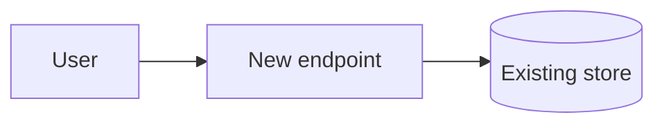

# Brainstorm: <feature>

Picked by: <person|agent>
Style: route

## Idea

<The ask in the user's words, and the answers to the questions you asked.>

## What exists

<What the scouts found and you checked: the nearest existing code, the files that would change. Mark what you did not check as unverified.>

## Options

### A. <name>

- Pros: <...>
- Cons: <...>
- Size: <tickets, or S, M, L>
- Risky areas: <auth, secrets, money, data loss, limits, hostile input; or none>

### B. <name>

<Same shape.>

## Chosen

<A or B, and why, in the user's words where you can. The planner copies its diagram into spec.md's Design.>

## Rejected

- <B>: <one line on why, so nobody re-opens it>

## Consulted

<Answers from the architect, designer or product owner, or none.>

## Risks for the planner

<Areas of the chosen option that should be level 3 or on the Sensitive: line.>

## Open

<What still needs an answer. It goes under Unsure in the brief.>
