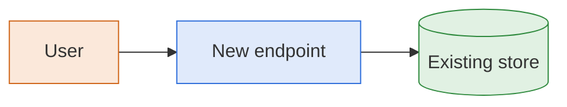

# Brainstorm: <feature>

Picked by: <person|agent>
Style: <route|blueprint|sketch|paper|terminal|bright>
Type: <standard|learn|map|quick|explore>
Scouts: <code=off|light|normal|deep web=off|light|normal|deep, or leave the line out for the type's levels>

## Idea

<The ask in the user's words, and the answers to the questions you asked.>

## Glossary

<Type learn only: each domain term the brainstorm uses, one line in plain words, with the link or file it came from. Leave the section out for the other types.>

## Repo map

<Type map only: the parts of the repository the idea lives in, one line each with its folder, what calls what, and where the tests are. Leave the section out for the other types.>

## What exists

<What the scouts found and you checked: the nearest existing code, the files that would change. Mark what you did not check as unverified.>

## Options

### A. <name>

- Pros: <...>
- Cons: <...>
- Size: <tickets, or S, M, L>
- Risky areas: <auth, secrets, money, data loss, limits, hostile input; or none>

### B. <name>

<Same shape.>

## Verdict

<Type explore only: Go or No-go, and why in two or three lines. On a No-go, leave Chosen, Rejected and the rest out. Leave the section out for the other types.>

## Chosen

<A or B, and why, in the user's words where you can. The planner copies its diagram into spec.md's Design.>

## Rejected

- <B>: <one line on why, so nobody re-opens it>

## Consulted

<Answers from the architect, designer or product owner, or none.>

## Risks for the planner

<Areas of the chosen option that should be level 3 or on the Sensitive: line.>

## Open

<What still needs an answer. It goes under Unsure in the brief.>
