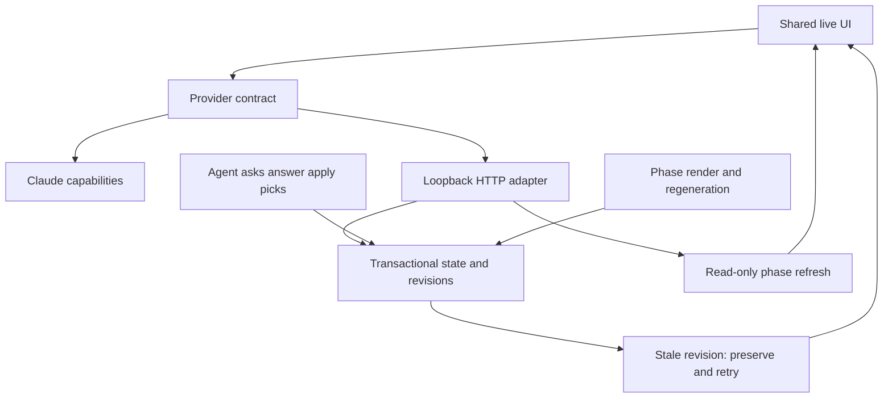

# Portable live page — Spec

## Problem

Forkboard's browser directly requires Claude artifact capabilities. Codex users receive a static fallback, cannot persist page interactions in a local live session, and cannot watch Build progress. FeatureFlow already composes Style, Team, Options, Plan and Build, but its command currently requires brainstorm Markdown before it can render any phase.

## Goal and the bar

Support the existing Claude native artifact experience and a persistent localhost browser experience for Codex across brainstorm, draft planning, active builds and completed builds. Reuse asks, answer, apply and picks while keeping existing conductor approvals authoritative.

The automated bar is `python3 -m unittest discover -s plans/portable-live-page/acceptance -v` (prints `OK`), plus the frozen Test command (offline scripts, Python and Chromium suites all pass). Document a manual Codex smoke run using local launch and explicit agent request processing. Acceptance tests can launch subprocesses and a loopback server in temporary folders and drive Chromium through the already installed Playwright dependency; no network, model or account is needed after dependency setup.

## Stories

### Review and save from either host

**As a** reviewer, **I want** one live page with diagrams, questions and choices, **so that** my work reaches the agent in Claude or Codex.

- [ ] Claude still obtains artifact, user and optional sample capabilities, publishes with its existing SHA precondition, respects read-only and capability-denied behavior, and supports native diagram generation.
- [ ] A local page works without `window.claude`, saves a diagram version and layout, compares it with the original, persists across a backend restart, and displays the configured agent label (Codex by default locally; Claude by default natively).
- [ ] A stale revision never overwrites a newer save, answer or regenerated round. After a conflict the latest state is fetched and the pending operation is replayed once against it; a second conflict or unavailable storage visibly retains pending work for retry. An ask is not duplicated by retries.
- [ ] Questions, completed-step Change requests and local diagram-change requests appear in the agent's existing asks output, including the diagram and source context where relevant. They remain queued across disconnect/restart until explicitly answered.
- [ ] Text replies and optional validated diagram proposals become visible after refresh; a proposed diagram is previewed without silently replacing the reviewer's unsaved graph. Save as my version is explicit, and applying to Markdown still checks its source fingerprint.
- [ ] Style, Team, Options and draft Plan choices are staged locally until that tab's Approve atomically persists its picks, approval and approval ask. Plan Approve expresses the user's plan yes; the agent processes it through existing named commands and approval policy. The page writes only its state.json and cannot execute builds/commits, disable a gate, or modify repository files. Change removes that step's approval and later approvals and queues a reopen ask. Accepted plan/build settings remain frozen; changing them requires an explicitly approved re-plan.

### Follow every phase

**As a** feature owner, **I want** the same page throughout the flow, **so that** progress and choices do not disappear between stops.

- [ ] Brainstorm shows the existing five tabs: Style, Team, Options, Plan and Build, with staged choices, atomic Approve and Change/reopen behavior. Draft plans show tickets, dependencies, build controls and checks. Accepted plans show frozen choices and active ticket statuses; completion shows all tickets done.
- [ ] A feature with draft or accepted tasks but no brainstorm.md can launch, render and process questions/plan picks. Style/Team/Options explicitly say they were not used; no synthetic brainstorm file is written. Brainstorm diagram apply reports unavailable when there is no source.
- [ ] The local page notices answers, page regeneration and external ticket-status changes within five seconds while connected. No agent wakeup or manual server restart is needed to read status. A disconnected page shows its status and reconnects without losing edits.
- [ ] Refresh does not discard dirty diagram edits, typed questions, pending saves or selected versions. Content changes that cannot merge safely show an update-available control and preserve work before replacement; a changed figure source blocks blind replay.

### Use the tools safely

- [ ] Local startup prints the actual loopback URL and state folder, supports port 0 for tests and an explicit port, and fails clearly on a busy port or absent feature instead of exposing another interface.
- [ ] Only the page and narrow API resources are served. Traversal, symlinks escaping the live folder, foreign Host/Origin, unsupported methods, oversized or malformed bodies and invalid operations fail without any state/file mutation. No directory listing, arbitrary file read/write or command execution route exists.
- [ ] Concurrent agent answers, local browser operations and page regeneration use the same cross-process transaction mechanism. Existing valid state is preserved, corrupted state produces an actionable error without being reset, and interrupted writes leave the prior committed state readable.

## Scope

In: provider-neutral browser transport, unchanged Claude compatibility adapter, localhost backend, persisted revision and queued requests, agent labels, all phase rendering and refresh, launch/request commands, CLI/skill/guide docs, adapter/backend/phase and package coverage.

Out: public hosting, shared remote authentication, browser API keys, automatic Codex chat wakeups, changing approval policy, automatic execution of build instructions, new model SDKs, replacement of Forkboard's graph editor or conductor.

## Happy path

1. Agent runs the existing live renderer with a local provider and starts the loopback server; the user opens its printed URL.
2. User edits a diagram, saves a version, submits a question and picks a draft setting; the backend persists operations with revision checks.
3. Agent explicitly checks asks, answers or attaches a diagram proposal, applies selected versions/picks using existing validated commands, and regenerates the page as needed.
4. Browser polls for state/page changes; the same URL advances through draft and accepted Plan to active and completed Build with the agent processing approval intent; the server itself executes no build or commit.

## Design



### Decisions

- **Adapter seam** — options: wrap the existing Claude calls behind one contract, or duplicate the whole UI per host. Choose the contract; reject duplication because saves, limits, graph validation and rendering already exist. Capability absence remains explicit. Keep native artifact signatures as tested by the repository; do not replace them with assumptions about newer Claude products.
- **Storage** — options: keep JSON with atomic replacement and a shared cross-process lock, or introduce SQLite. Choose JSON so existing state files and agent tools remain useful; reject database migration. Every supported writer must lock, reload latest, mutate and atomically replace in the same directory. Lock acquisition is bounded and fails closed with recovery guidance; never silently delete an ambiguous live lock. Corrupt existing JSON is never treated as an empty new page.
- **HTTP writes** — options: accept arbitrary replacement state, or accept narrow validated change operations with a revision precondition. Choose operations; reject whole-state overwrite because browsers must not erase agent answers or impersonate authoritative source/round data. A strong content revision and If-Match/412 express optimistic concurrency.
- **Refresh** — options: bounded polling, or SSE/WebSockets. Choose polling every two seconds with retry/backoff, stopping timers on teardown; reject persistent channels for the first local release. Read-only source fingerprint checks regenerate phase output when necessary; browser payloads never select executable work.
- **Diagram assistance** — options: add browser-held model credentials, or persist requests for the current agent. Choose queued requests and retain optional native Claude sampling; reject browser model keys. A reply may include a validated graph proposal, but application remains explicit.
- **Phase entry** — options: require a synthetic brainstorm for all plans, or render a plan-derived base document when none exists. Choose the fallback using spec/map metadata and existing Plan/Build composition; reject fabricating a user decision or Markdown source. Preserve the existing command name and status aliases.
- **Packaging** — options: new external service/dependency, or Python 3.9 standard library plus existing inline asset packaging. Choose the existing package distribution; reject an additional runtime stack. Existing assets/* globs already include adapter assets.

## Interfaces

Provider selection is explicit renderer configuration (`claude` or `local`), with old live Boolean callers continuing to mean Claude. The shared browser adapter contract supplies identity/profiles, readState -> {state, revision}, saveChange(change, revision) -> {state, revision}, optional native diagram proposal capability, refresh metadata and an agent label. Direct `window.claude` access belongs only in its adapter. Plain static rendering still works without either capability.

Standalone commands (from the installed Forkboard command, or `PYTHONPATH=packages/forkboard python3 -m forkboard` in a checkout):

- `forkboard live DOC DIR [--provider claude|local] [--agent-label TEXT] [--theme NAME]` (default Claude).
- `forkboard serve DIR [--port N]` (default loopback 127.0.0.1, default port 0; no non-loopback binding option).
- Existing `asks STATE`, `answer STATE N TEXT`, `version STATE FIGURE VERSION`, `picks STATE` remain supported. Add `answer-graph STATE N GRAPH_JSON_FILE` for a graph proposal attached to an existing diagram request; it does not change a source diagram or approve a plan.

FeatureFlow commands, retaining old usage and `python3 scripts/flow-status.py FEATURE --page` / `--brainstorm-page` aliases:

- `python3 -m feature_flow brainstorm-page FEATURE --live DIR [--provider claude|local] [--agent-label TEXT]` generates the current phase.
- `python3 -m feature_flow brainstorm-page FEATURE --serve DIR [--port N] [--agent-label TEXT]` generates a local page and serves it with read-only phase refresh from the repository.
- Existing `--asks DIR`, `--answer DIR N TEXT`, `--apply DIR FIGURE VERSION`, `--picks DIR`; add `--answer-graph DIR N GRAPH_JSON_FILE`. These must function without a brainstorm when the operation only needs state or a draft. Plan selection respects FLOW_DIR and draft discovery; accepted plans take precedence.

HTTP surface, same origin only:

- `GET /` -> generated index.html; `GET /state.json` -> state with strong ETag; `GET /api/page` -> {revision, round, phase} describing the current rendered page (refreshes from trusted repository files in FeatureFlow mode).
- `POST /api/change`, JSON {id, change}, `If-Match: <revision>` -> committed state and ETag; stale precondition -> 412 without mutation. Missing precondition, unknown fields/operations or malformed state -> a 4xx error with actionable text. Operation variants include version, ask, single pick outside stepped choices, and the existing compound approval/reopen payloads. Approve uses {picks: [{key, entry}], approve: {step, by, at}, ask: {by, at, figure: null, version: null, step, approve: true, text}} in one transaction; Change uses {unapprove: [step and following step names], ask: {by, at, figure: null, version: null, step, text}}. Validate against the latest trusted document's available steps/choices and frozen accepted-plan state, normalize identity/time server-side, and commit all or nothing. Preserve ask.about for option and ticket questions. These operations record intent only and never write repository files. IDs make retransmission idempotent; preserve existing ordinal ask numbering and append stable request IDs.
- Local identity is one persistent local reviewer identity supplied by the backend, not a hosted access-control system. Browser cannot write answers, source fingerprints, round, original graphs or agent identity. No CORS wildcard; Host must match the listening loopback origin and write Origin must match exactly. Keep body/state/graph/text bounds explicit and tested; reject oversized input before reading unbounded data.

The persisted state retains feature, round, figures, versions, asks, picks and approved ({step: {by, at}}). Optional request fields capture id, kind (question/diagram/step), figure, source fingerprint, graph snapshot and optional result graph; old states without these remain readable. Replies retain answer text. Atomic managed operations are shared by both CLI families and backend. Page metadata/provider config is escaped in HTML and cannot be supplied through arbitrary API paths.

## Migration and compatibility

No data conversion script: additive fields and backward-compatible defaults only. Existing Claude artifacts and original state files load unchanged. Existing CLI arguments and static rendering retain their defaults. New Python modules ship both as forkboard and feature_flow._forkboard; adapter JS is embedded by page.render and ships through existing asset globs. Every existing writer of state.json must join the transaction API, including both live render paths and both answer paths.

## Risks

- Lost browser/agent updates — shared lock and reread, conditional operations, atomic replacement, race tests against subprocess writers.
- Source figure numbers drifting after regeneration — source fingerprints and explicit stale-context feedback; never attach an old edit to an unrelated figure.
- Hostile localhost callers — narrow handler, loopback binding, exact origins and hosts, bounded validation, escaped labels/replies, no executable endpoint.
- Native API regression — preserve current mocks and exercise denied/read-only/native generation alongside local backend tests.

## UI

### Connected local draft

```
┌──────────────────────────────────────────┐
│ Feature review           Codex • Connected│
│ Style ✓ Team ✓ Options ✓ Plan Build           │
│ Plan: 7 tickets                          │
│ Profile [Standard]   Lanes [Auto]         │
│ Choices staged • Approve sends your yes.     │
│ [Save as my version] [Ask Codex]          │
│ Talk to Codex                            │
│ [Your question or request____________]   │
│ [Send to Codex]                          │
└──────────────────────────────────────────┘
```

### Waiting, reply and build update

```
┌──────────────────────────────────────────┐
│ Codex • Connected                        │
│ Add a cache before the database          │
│ Waiting for Codex                        │
│ Codex: Added a cache proposal.           │
│ [Preview proposal] [Save as my version]  │
│ Build: 3 of 7 tickets done               │
│ Approved settings • change via re-plan   │
└──────────────────────────────────────────┘
```

### Conflict or disconnect with edits

```
┌──────────────────────────────────────────┐
│ Connection lost • Retrying               │
│ Your pending changes are kept.           │
│ New page available; keep your edits.      │
│ [Retry save] [Review update]              │
└──────────────────────────────────────────┘
```

### Plan without brainstorm

```
┌──────────────────────────────────────────┐
│ Style/Team/Options: not used       │
│ Plan: draft • choices are proposals       │
│ Build: waiting for plan approval          │
│ No brainstorm diagram to apply.           │
│ Talk to Codex [____________________]      │
└──────────────────────────────────────────┘
```

### Files and read-only reality

Preserve docs/source-of-truth.md: files hold decisions; the page is their regenerated view and writes only page state. --picks writes validated approved picks into the brainstorm/draft; --apply writes a selected diagram with its source guard; --answer writes page replies. Plan Approve is user approval intent, processed by the session, and never an HTTP build/commit command. Build keeps the existing read-only Plan vs reality table derived from ticket Touches/levels and the run log (CHANGED, FOOTPRINT-*, LEVEL-*, DECISION, FOLLOWUPS, REPLAN, REPAIR), including decisions/followups. Refresh these inputs within the existing five-second bound without inventing authoritative page state.
